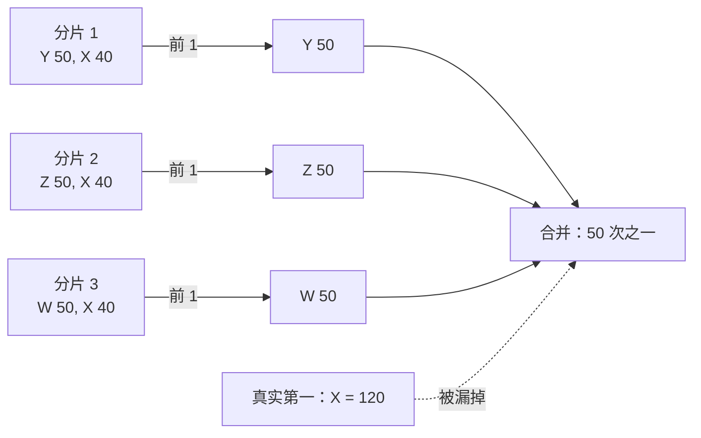

## Q
**Top K · 分片键选错：前 K 合并为什么失效**｜考点 · 必会

团队为了让写入更均匀，把播放事件按事件 ID 的哈希散到 3 个分片，再向每个分片取前 1 名合并。分片 1 的播放数：Y 50、X 40；分片 2：Z 50、X 40；分片 3：W 50、X 40。算出合并结果和真实第一，说明错在哪、怎样改。

## A
- **合并结果：** 每个分片的第一名是 Y、Z、W，合并后第一名是 50 次的任意一个。
- **真实第一：** X 在三个分片共 40 + 40 + 40 = 120 次，才是第一，却被漏掉了。

- **错因：** "每个分片的前 K 必含全局前 K"成立的前提是：每个视频的计数完整落在同一个分片。按事件散列后，同一视频被拆开，分片内的局部排名不代表全局排名。
- **改法：** 按视频 ID 分片（与 Kafka 分区键一致）；若必须按其他键，就要把每个分片所有计数（不止前 K）汇总后再排，成本等同全量聚合。
- **代价：** 按视频分片会让爆款视频集中到一个分片，要另行处理热点。
