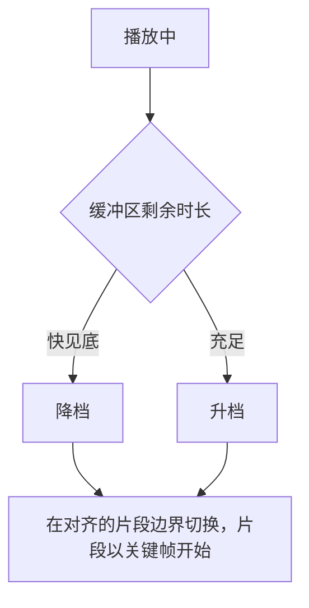

## Q
**YouTube 视频平台 · 自适应码率在工业上怎么落地：HLS 与 DASH**｜拓展 · 加分

清单文件和自适应码率在真实系统里叫什么？片段时长、码率档位和切换点怎么选？

## A
- **两种主流协议：** HLS（苹果提出，主清单与媒体清单是 `.m3u8` 文本）和 MPEG-DASH（清单是 `.mpd`）。两者思路相同：一份描述各清晰度版本的清单，加上许多几秒长的小片段，用普通 HTTP 取，所以能直接走 CDN 缓存。
- **片段时长的取舍：** 片段越短（约 2 秒），能更快切换码率、适应网速变化，但请求数多、编码压缩效率略差（每个片段要从一个关键帧开始）；越长（约 10 秒），请求少、压缩好，但网速变差时反应慢、首屏慢。常见值在 2–10 秒。
- **码率阶梯（bitrate ladder）：** 同一视频转成几档分辨率和码率（如 240p 到 1080p 以上），档位之间要有足够间隔，也不能太多（每多一档就多一份存储和转码成本）。
- **切换要无缝：** 各档的片段边界要对齐到同一个时间点，且每个片段以关键帧开始，播放器才能在片段之间切换而不花屏。
- **客户端怎么选档：** 简单的按最近下载吞吐估计选档；更稳的看缓冲区剩余时长，缓冲快见底就降档，充足就升档。
- **口述方式：** 说"清单加小片段，走普通 HTTP，所以 CDN 能直接缓存"，把设计与实际协议连起来。

