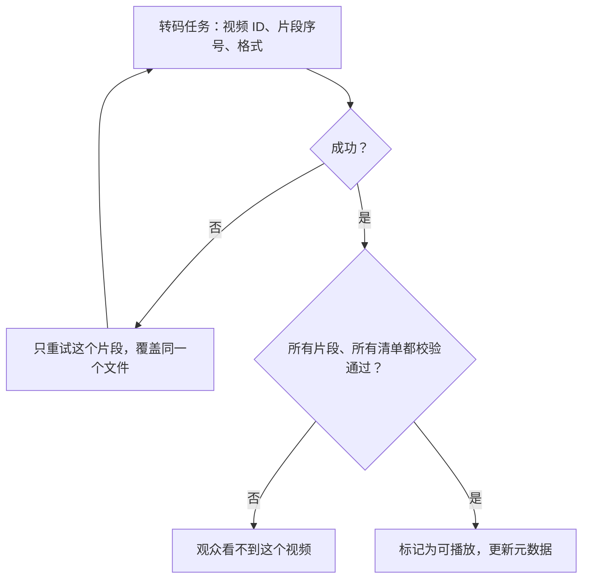

## Q
**YouTube 视频平台 · 转码流水线：怎么切、失败怎么办**｜拓展 · 加分

切片转码流水线里，在哪里切才能独立播放？某个片段转码失败或 worker 崩了怎么保证结果正确？

## A
- **切点必须在关键帧：** 压缩视频里大部分帧依赖前面的帧，只有关键帧（IDR 帧）能独立解码。若在任意位置硬切，这个片段开头的帧缺少依赖，无法单独播放。所以切片点要对齐关键帧，各档清晰度的切点要一致（才能无缝切换）。
- **每个任务做成幂等：** 输出路径由（视频 ID，片段序号，格式）决定，worker 崩了重试就覆盖同一个文件，不会产生重复或半个文件，调度器可以放心重试。
- **失败只重试局部：** DAG 的好处是失败的片段单独重试，已完成的不重做；多次失败的片段转人工或标记视频失败。
- **掉队者（straggler）：** 少数 worker 因机器慢拖慢整体，可以对超过中位数很多的任务另起一个副本，谁先完成用谁。
- **完成判定：** 只有所有片段、所有清单都存在并校验通过，才把视频标记为"可播放"并更新元数据；在此之前观众看不到这个视频。
- **编排器的作用：** Temporal 一类系统把每一步的结果持久化，进程崩溃后从断点继续，不必从头开始。
- **模式。** 幂等任务加局部重试：让每一步的输出由输入唯一决定，失败后可以放心重做。

