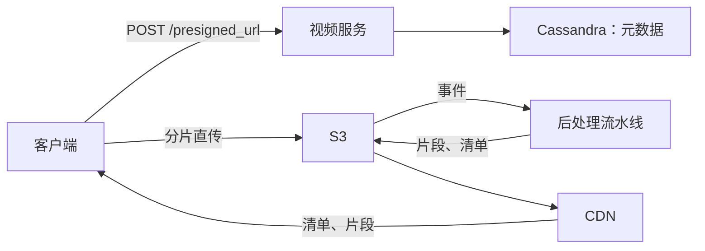

## Q
**YouTube 视频平台 · 完整解答**｜摘要 · 必会

设计一个类似 YouTube 的视频平台：用户上传视频（可达几十 GB），其他人能流畅观看，网差时也不卡。每天约 100 万个上传、1 亿次观看。给出需求、实体与接口、整体设计、深入问题、各级别期望。

## A
**一句话。** 功能只有"上传"和"观看"，但视频又大又要适配各种设备和网速：难点是上传怎么绕过应用服务器并能续传、视频怎么处理成可自适应播放的片段，以及远距离观众怎么不卡。

**60 分钟路线。**

| 时间 | 做什么 |
|---|---|
| 0–5 分 | 需求与规模：上传 1M/天，观看 100M/天，视频几十 GB，可用性优先，要续传 |
| 5–10 分 | 实体 User / Video / VideoMetadata 与上传、观看接口 |
| 10–25 分 | 高层设计：元数据入 Cassandra，视频直传 S3；存成"多格式 × 小片段"；观看用自适应码率 |
| 25–50 分 | 必讲：后处理流水线（DAG）；断点续传；各组件扩展、热门视频、CDN |
| 50–60 分 | 追问：边传边处理、续看进度、观看计数 |

- **需求**
  - 功能：上传视频；观看（流式播放）。搜索、评论、推荐、频道、统计不做
  - 非功能：可用性优先于一致性；支持几十 GB 的大视频；网差也低延迟播放；每天约 100 万上传、1 亿观看；上传可续传
- **实体与接口**：User、Video、VideoMetadata；`POST /upload` 后来变成 `POST /presigned_url`（只传元数据，换回预签名地址）；`GET /videos/{id}` 只返回元数据，里面有清单文件地址
- **基础概念**：编解码器（codec）负责压缩；容器（container）是文件格式；码率（bitrate）= 单位时间的数据量；清单文件（manifest）是片段的索引，分主清单（列出所有版本）和媒体清单（列出某版本的所有片段）
- **整体设计**
  - 元数据：每年约 3.65 亿条，用 Cassandra，按 videoId 分区（只做点查）
  - 视频：客户端用预签名 URL 分片直传 S3（multipart upload），不经过应用服务器
  - 存储形态：原片不够，多格式不够，要"多格式 × 几秒的小片段"，这样才能边下边播
  - 观看：整片下载太慢（10GB 在 100Mbps 下要 13 分钟以上）；按片段下载更好；自适应码率（ABR）最好：客户端先取清单，按网速在不同清晰度的片段间切换
- **深入一，后处理（必讲）**：S3 事件触发流水线：切片 → 并行转码、音频、字幕 → 生成清单 → 标记完成。这是 DAG，转码最吃 CPU，要高度并行，用 Temporal 之类编排，临时文件放 S3、只传 URL
- **深入二，断点续传（必讲）**：客户端切 5–10MB 块并算指纹；元数据里存每块状态；每块传完把 ETag 回传服务端校验；断了就取元数据，跳过已传的块
- **深入三，扩展（必讲）**：视频服务无状态水平扩；Cassandra 靠副本和缓存缓解热门视频；处理服务靠队列削峰、队列长度触发扩容；S3 在单区域，用 CDN 缓存清单和片段服务远处观众
- **追问再讲**：客户端边切边传、让处理流水线化；续看位置；观看计数（精确还是估算）
- **级别**：中级收敛到分片上传和按片段播放；高级讲清分片续传与后处理；Staff 主导并往深处走
