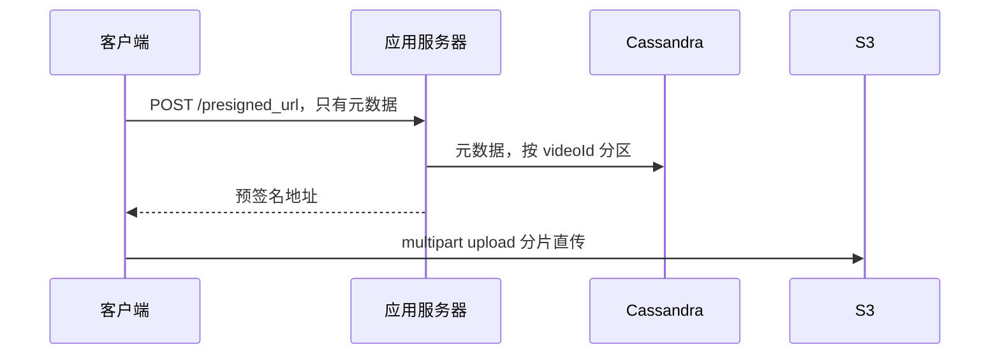

## Q
**YouTube 视频平台 · 高层设计：元数据存储与上传路径**｜摘要 · 必会

上传视频时，元数据和视频字节分别存哪？为什么要把 POST /upload 改成预签名 URL？

## A
- **三个问题：** 元数据（名称、描述等）存哪？视频数据（画面、音频）存哪？视频数据具体存成什么形态？
- **元数据：** 每天约 100 万个上传，一年约 3.65 亿条记录，要能水平分区，选 Cassandra：高可用，可选分区键。按 videoId 分区，因为只做点查，不做批量访问。
- **选分区键的思路：** 有些系统要精细分区才能让读落在少数节点；有些系统要某个范围内的一致性，需要按那个范围分片的关系库（如票务按演唱会分片）；还有些系统根本不用精细设计，这里按 videoId 点查，天然均匀。
- **视频字节：** 最高效的是客户端通过预签名 URL 分片直传 S3（multipart upload），和云盘类设计相同。大文件（large blob）模式：字节不经过应用服务器。
- **接口变化：** `POST /upload` 变成 `POST /presigned_url`；请求里只有元数据，没有视频文件，服务端返回上传用的预签名地址。
- **为什么：** 经应用服务器中转几十 GB 的文件会占满带宽与连接，也没有任何额外价值。

