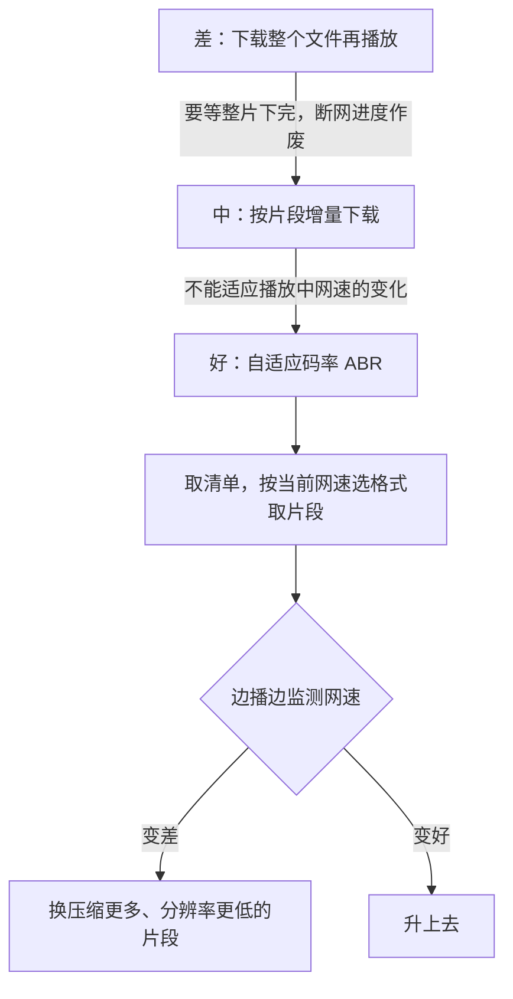

## Q
**YouTube 视频平台 · 高层设计：观看——从整片下载到自适应码率**｜摘要 · 必会

观看方案从整片下载、按片段下载到自适应码率流式播放，每一步解决了什么？

## A
- **元数据：** 观看时先从元数据库取 VideoMetadata，`GET /videos` 改成只返回元数据，其中有播放所需的链接。
- **差：下载整个文件再播放。** 严格说这不是流式。要等整片下载完才能播，10GB 的视频在 100Mbps 下要 13 分钟以上（10GB = 80Gb，÷ 0.1Gbps = 800 秒）；若是单个 HTTP 请求，中途断网，已下载的进度全部作废。
- **中：按片段增量下载。** 客户端按设备、带宽、用户偏好（如 1080p）选一种格式，先取第一个几秒的片段就能开始播，后台继续取后面的片段。它依赖前面把视频存成了片段。缺陷：不能适应播放中网速的变化，网速变差时 1080p 片段下载变慢会卡顿。
- **为什么不等于"分块下载"：** 某些格式按顺序分块（如每次 5MB）下载也能播，但并非所有格式如此；按"可独立播放的片段"分，才能清楚地保证快速增量播放。
- **好：自适应码率（ABR）。** 上传时生成清单文件，客户端取清单，按当前网速选一种格式取片段；边播边监测，网速变差就换成压缩更多、分辨率更低的片段，变好就升上去，避免中断。
- **代价：** 客户端更主动，并依赖前面的切片、多格式存储和清单文件。

