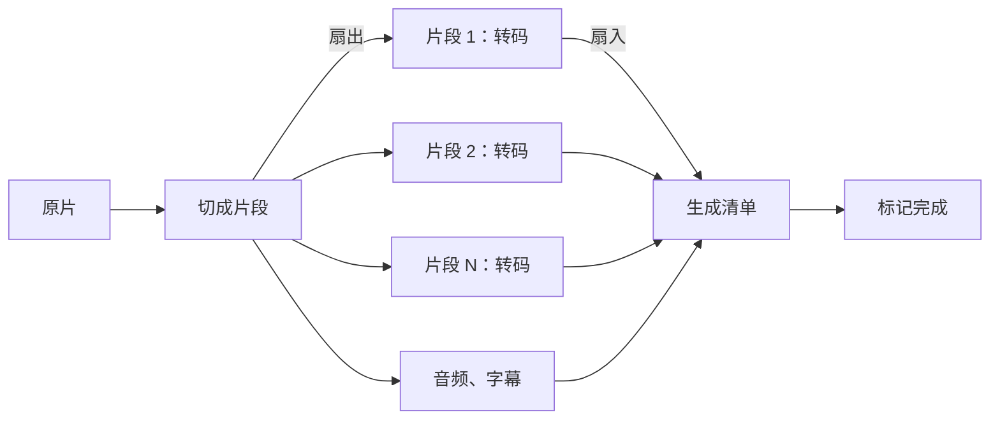

## Q
**YouTube 视频平台 · 深入一：视频后处理流水线（DAG）**｜摘要 · 必会

为了支持自适应码率，上传后的视频要经过哪些处理步骤？为什么说它是一个 DAG，怎么编排？

## A
- **产出：** 各种格式（编解码器加容器的组合）的片段文件，存在 S3；主清单和若干媒体清单，也存在 S3，媒体清单引用片段文件。
- **步骤：**
  1. 用 ffmpeg 一类工具把原片切成片段；
  2. 对每个片段转码（从一种编码转成另一种），并处理音频、生成字幕；
  3. 生成引用各片段、各格式的清单文件；
  4. 把上传标记为"完成"。
- **为什么是 DAG：** 这些步骤是有向无环图：每一步有依赖，有扇出（一个原片切成许多片段）和扇入（所有片段都完成才能生成清单）。片段之间互不依赖，可以分发到不同机器并行处理。
- **最贵的一步：** 转码最吃 CPU，应该在很多机器、很多核上高度并行。
- **编排：** 用现成的编排系统，如 Temporal（支持媒体处理工作流）来构建图并在合适时机给 worker 分任务。
- **临时数据：** 片段、音频文件都放 S3，worker 之间只传 URL，不传文件。
- **口述程度：** 不必画出 DAG 的每个细节，讲清输入、输出，以及怎样高效并行和编排即可。
- **优化：** 本设计假设整个原片传完才开始处理；若客户端边切边传，处理可以更早开始。

