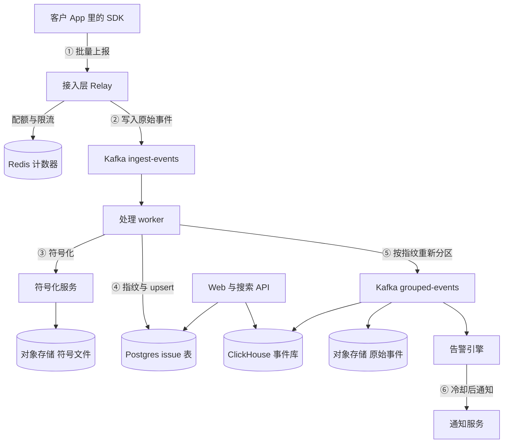

## Q
**全景**｜完整答案 · 错误追踪与异常聚合（Bugsnag、Sentry） · 必会

面试官：「设计一个类似 Bugsnag 或 Sentry 的错误追踪系统：客户的 App 和服务端程序出错时上报异常，我们把同一个 bug 的成千上万次上报聚成一个问题（issue），通知负责人，并能搜索和查看每一次发生的现场。从需求讲到深挖。」

## A
**一句话。** SDK 在客户端捕获、缓冲、批量上报；边缘接入层只做鉴权、配额和限流，把原始事件写进 Kafka 就返回；后面先符号化（把压缩或编译后的堆栈还原成源码位置），再规范化堆栈算指纹（fingerprint），按指纹 upsert 到 issue 表；每次发生的明细进列式事件库和对象存储，告警引擎只在「新 issue、回归、超阈值」时通知并带冷却。难点不是 QPS，而是突增：一个坏版本能让一个租户流量瞬间涨 100 倍，所以配额、突增保护和采样都在入口执行。

**需求。** 接收异常事件（堆栈、标签、面包屑即出错前的操作轨迹、用户、版本），把同一 bug 聚成 issue，issue 列表搜索、看单次详情、告警，状态未解决 / 已解决 / 忽略，已解决再出现算回归；不做性能追踪、会话回放。接入宁可丢弃也不能拖垮客户 App，过载回 429 让 SDK 退避；事件约 1 分钟内进列表，新 issue 告警 p99 1–2 分钟；计数最终一致、可采样但要可解释；一个租户的风暴不能拖慢别的租户。

**规模。** 平均 10 万事件/秒、峰值 ×3，单租户事故可到每秒几十万；每个事件 gzip 后约 5 KB，列式库每行约 200 B，保留 90 天：

| 项 | 结果 |
|---|---|
| 事件数 | 10⁵ × 86,400 ≈ 86 亿/天 |
| 入口带宽 | 平均约 500 MB/s，峰值约 1.5 GB/s |
| 原始事件 | 约 43 TB/天，90 天约 3.9 PB |
| 事件索引 | 86 亿 × 200 B ≈ 1.7 TB/天，90 天两副本约 310 TB |
| issue | 绝大多数事件命中已有 issue，新增每天约百万行 |

**架构。**

- **接入（①–②）：** Relay 无状态，校验 DSN、查配额、做突增保护，写 Kafka 成功即回 200，之后任何组件慢都只积压在 Kafka。
- **处理（③–⑤）：** 符号化必须在算指纹之前；按 `(project_id, fingerprint)` 重新分区，同一 issue 的计数由一个消费者批量累加。
- **存储与读：** issue 汇总在 Postgres，明细在 ClickHouse，完整原始事件在对象存储；搜索先在 ClickHouse 过滤聚合再回 Postgres 取状态。

**必讲深挖。**
- **接入：** SDK 批量压缩、本地持久化、遵守 429；Relay 先配额后写 Kafka，`acks=all`。
- **分组：** 符号化后只取项目内帧（in-app frames）的模块和函数名，去掉行号、地址、随机数，哈希成指纹；`INSERT … ON CONFLICT` 原子新建或累加。
- **突增与配额：** 每租户令牌桶加按基线的突增上限，超出在 Relay 丢弃并计数；同指纹超量后采样存储、照常计数。

**为什么这样。**
- 不在接入请求里同步处理：符号化要拉几十 MB 的 source map，慢且不稳，会拖慢客户请求，处理层一抖就全面 5xx。
- 不按消息文本分组：消息里有 id、时间、数字，一个 bug 变成上万个 issue；堆栈的位置才稳定。
- 事件明细不进 Postgres：每天几十亿行、任意标签聚合是列式库的活，关系库每个 bug 一行。
