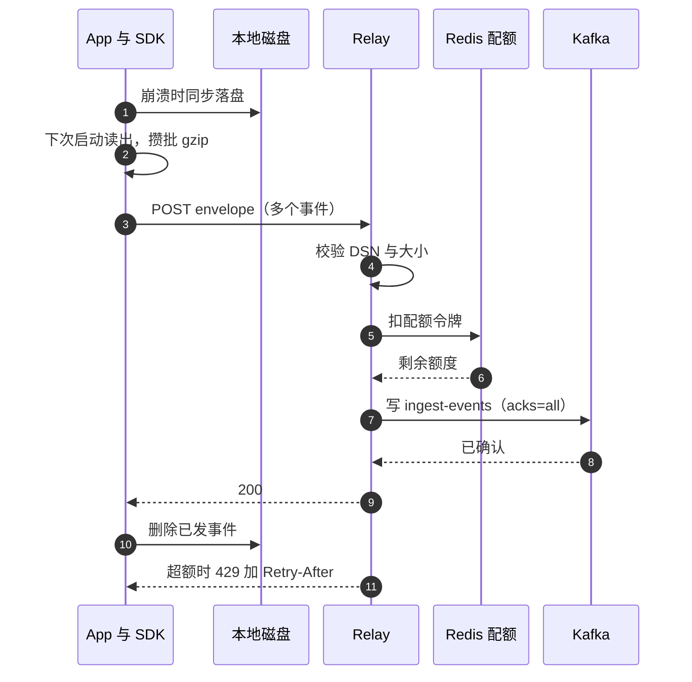

## Q
**SDK 捕获批量与接入层写队列**｜完整答案 · 错误追踪与异常聚合（Bugsnag、Sentry） · 必会

面试官：「SDK 在用户手机上捕获到一个崩溃，App 马上就要退出；网络可能没有；我们后端也可能正在过载。从捕获到事件安全进入我们系统，每一步怎么做？」

## A
**一句话。** SDK 用全局异常钩子捕获，崩溃时只把事件同步写本地磁盘、下次启动再发；平时放进有界内存队列，按条数或时间攒批、gzip 后后台发送，遇 429 按 `Retry-After` 暂停。接入层 Relay 无状态：校验 DSN、查配额、做突增保护，把原始事件写进 Kafka（`acks=all`）后才回 200；用 `event_id` 去重，重发无害。

**请求流程。**

**步骤。**
1. **捕获与组装：** 注册全局钩子（JS `window.onerror`、Python `sys.excepthook`、iOS/Android 信号与未捕获异常处理器）；事件带 `event_id`（UUID）、堆栈、release、environment、最近 100 条面包屑，客户端先脱敏（密码、token），并按 `sample_rate` 采样（服务端可经响应下发新采样率）。
2. **崩溃路径与攒批：** 进程正在死去不能做网络请求，只同步写本地文件，下次启动发；正常路径放有界内存队列（如 100 条），每 N 条或几秒 gzip 发一次，队列满了丢最旧的，绝不阻塞业务线程。
3. **Relay 校验与配额：** 从 URL 取 `project_id`、头部取 DSN 公钥，查本地缓存的项目配置并检查大小上限；按组织、项目扣令牌桶（Redis Lua 原子补令牌再扣），不够整批或部分回 429，`Retry-After` 和 `X-Sentry-Rate-Limits` 里写明哪类被限、多久。
4. **写队列与收尾：** 按 `project_id` 加随机后缀分区写 `ingest-events`（`acks=all`、生产者幂等），确认后才回 200，SDK 收到 200 才删本地副本；网络错误或 5xx 指数退避加抖动，429 期间直接丢弃同类新事件只计数。

**故障。**
- **崩溃时网络不通：** 事件已在磁盘，下次启动重发；本地文件有上限（如 30 个），最旧先删。
- **SDK 重试导致重复：** 处理端用 `SET event:{project}:{event_id} 1 NX EX 86400` 去重，列式库按 `event_id` 兜底。
- **Relay 宕机：** 无状态，负载均衡切走，请求中断的 SDK 没收到 200 就重发。
- **Kafka 变慢或不可用：** Relay 有界缓冲，满了回 503 让 SDK 退避，绝不无限缓冲；处理层积压只表现为 consumer lag，不影响接入。
- **配额 Redis 不可用：** Relay 用本地近似计数继续放行（fail-open），宁可短时超额也不拒收全部流量；超大事件回 413 或裁掉面包屑、截断局部变量。

**为什么这样。**
- 不在接入请求里同步处理：处理慢一次客户请求就堆积，写队列即回把两边故障隔开。
- 不让 SDK 每事件一个请求：移动端电量流量贵，弱网请求越多失败越多。
- 不在崩溃时尝试网络发送：进程状态已坏，可能死锁或二次崩溃，落盘是唯一可靠动作。
- 限流不放处理层：那时字节已进 Kafka 占了带宽存储，越靠前丢越便宜。

**数字。** 入口平均约 500 MB/s、峰值约 1.5 GB/s，Relay 每实例按几千请求/秒估、横向扩；去重窗口 24 小时，覆盖 SDK 重试和下次启动重发。
