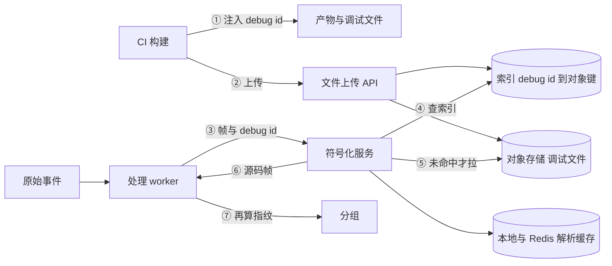

## Q
**符号化：source map、dSYM 与 mapping 文件**｜完整答案 · 错误追踪与异常聚合（Bugsnag、Sentry） · 追问

面试官：「前端代码上线前被压缩成一行，iOS 崩溃上报的是一串内存地址，Android 的类名被混淆成 `a.b.c`。我们怎么把它们还原成可读的堆栈？放在流水线的哪一步？」

## A
**一句话。** 发版时 CI 把调试文件（JS source map、iOS dSYM、Android R8/ProGuard mapping）连同唯一 debug id 上传对象存储；处理 worker 在算指纹之前调用符号化服务，按事件里的 debug id 找到文件，把（文件，行，列）或地址翻译成源码文件、函数、行号。解析好的文件按 debug id 缓存，因为同一版本的事件会反复命中同一份。

**流程。**

**步骤。**
1. **打标与上传：** 构建工具给每个产物生成唯一 debug id（JS 写进压缩文件末尾注释和 source map，iOS 用 Mach-O 自带 UUID，Android 的 R8 mapping 写 UUID 进 APK 元数据）；CI 用 `sentry-cli` 一类工具上传，索引记 `(project_id, debug_id) → 对象键`，按 `(release, 文件名)` 兜底。
2. **事件携带与查找：** SDK 附上已加载模块列表（debug_meta），每帧带 debug id 和指令地址，或 JS 的文件名、行、列；符号化服务先查本地内存磁盘缓存，再共享缓存，最后才从对象存储拉。
3. **翻译：** JS 的 source map `mappings`（Base64 VLQ）二分查最近的段，并可从 `sourcesContent` 取上下几行源码；原生是地址减模块加载基址得到相对偏移，在 DWARF 里查函数和行号，内联函数展开成多帧；Android 按 mapping 把 `a.b.c` 换回原类名方法名。符号化后的帧替换原帧（保留原始值），再进规范化与指纹计算。

**故障。**
- **调试文件晚到：** CI 先发版后上传，最早的事件找不到文件。事件照常入库并标「未符号化」，按原始帧临时分组；文件到了后台重处理该 release 近期事件，并把临时 issue 合并到正确 issue。文件始终缺失则不阻塞流水线，issue 上提示缺 source map。
- **大文件拖慢：** source map 可达几十 MB、dSYM 几百 MB；解析结果缓存，符号化服务按 debug id 一致性哈希路由，同一文件总落同一台。
- **符号化服务超时或宕机：** worker 超时后带原始帧继续走（降级），事件进重处理队列稍后再试。
- **同 release 重复上传不同文件：** 以 debug id 为准，同名不同内容不会覆盖；只按 release 加文件名查找容易错配。source map 含源码，只在服务端用，按项目权限隔离。

**为什么这样。**
- 不在 SDK 端符号化：调试文件不能随 App 发给用户（体积和源码泄露），设备也没算力。
- 不在分组之后再符号化：压缩后的行列号每次发版都变，先分组会让同一个 bug 每个版本成一个新 issue。
- 不按 URL 抓线上 source map：线上通常不公开，下载慢且可能版本不匹配。

**数字。** 同时活跃的 release 只有少数几个，热点文件极少，解析缓存命中率可以很高；重处理只回补最近几天、该 release 的未符号化事件，控制成本。
