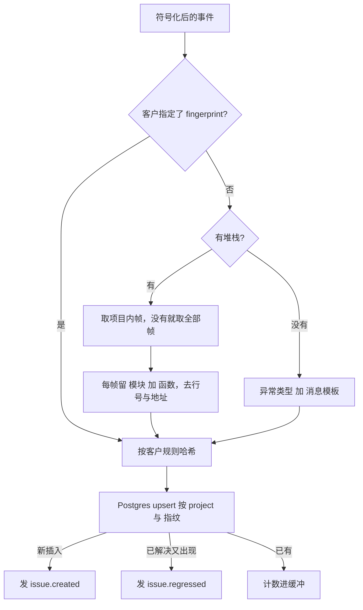

## Q
**指纹与分组：规范化堆栈帧，只看项目内帧**｜完整答案 · 错误追踪与异常聚合（Bugsnag、Sentry） · 必会

面试官：「同一个空指针 bug 一天上报一百万次，消息里带着不同的用户 id，行号每次发版都变，堆栈底部是框架代码。你怎么判定它们是同一个 issue？新 issue 怎么保证只创建一次、只告警一次？」

## A
**一句话。** 符号化后取堆栈里的项目内帧（in-app frames，客户自己代码的帧，不含标准库和第三方库），每帧只保留模块和函数名并规范化（去行号、地址、匿名函数编号、版本哈希），连同异常类型哈希成指纹；没有可用堆栈才退回「异常类型 + 去掉变量的消息模板」。指纹进 Postgres 唯一键，`INSERT … ON CONFLICT DO UPDATE` 原子新建或累加，只有真正插入的那一次发 `issue.created`。

**流程。**


**步骤。**
1. **选帧与规范化：** in-app 规则（如包名前缀 `com.acme.`、路径不含 `node_modules`）选帧，全是库帧时才用全部，递归重复帧折叠；每帧保留模块（路径去掉版本哈希和构建目录）与函数名，去行号列号地址，把 `lambda$3`、`<anonymous>`、生成代码的哈希后缀统一替换。
2. **组合：** 异常类型 + 从抛出点起前若干帧，SHA-1 一类哈希成指纹；无堆栈时消息模板化，数字、UUID、十六进制、引号里的值换成占位符，`user 42 not found` 与 `user 7 not found` 得同一模板。客户可传 `fingerprint` 或配规则，`{{ default }}` 表示在默认指纹上再加一维（如上游服务名）。
3. **原子 upsert：**
   ```sql
   INSERT INTO issue (project_id, fp_hash, title, first_seen, last_seen, times_seen)
   VALUES ($1, $2, $3, $4, $4, $5)
   ON CONFLICT (project_id, fp_hash) DO UPDATE
     SET last_seen = GREATEST(issue.last_seen, EXCLUDED.last_seen),
         times_seen = issue.times_seen + EXCLUDED.times_seen
   RETURNING issue_id, status, (xmax = 0) AS inserted;
   ```
   `inserted = true` 才发 `issue.created`；resolved 的用 `UPDATE … SET status='regressed' WHERE status='resolved'`，影响一行才发 `issue.regressed`。
4. **重新分区：** 事件带 `issue_id` 写 `grouped-events`，key 为 `(project_id, fp_hash)`，同一 issue 落同一分区同一消费者，便于批量累加和告警计数。

**故障。**
- **热点 issue 写爆一行：** 一百万次/分钟更新同一行会锁冲突；消费者内存里按 issue 攒 1–10 秒一次 `times_seen + n`，或先 Redis `INCRBY` 定时刷回；首次出现仍立即 upsert。
- **两个 worker 同时见到新指纹：** 唯一键保证只有一个插入成功，`issue.created` 只发一次；消费者崩溃重放可能多计，先按 `event_id` 去重，计数近似可接受，新建和回归靠唯一键与条件更新。
- **分组太粗：** 统一错误处理函数把所有异常包一层，把包装帧标成非 in-app 或让客户加规则拆分。
- **分组太细：** 堆栈里有动态函数名，提供手动合并，`old_fp → issue_id` 存映射表，后续事件先查映射。
- **改分组算法：** 带版本号逐项目迁移，迁移期两个版本都算、旧指纹映射到已有 issue，避免海量「新 issue」告警。

**为什么这样。**
- 不用行号：每次发版代码一挪行号就变，同一 bug 变新 issue。
- 不用完整消息：id、时间让每个事件独一无二。

