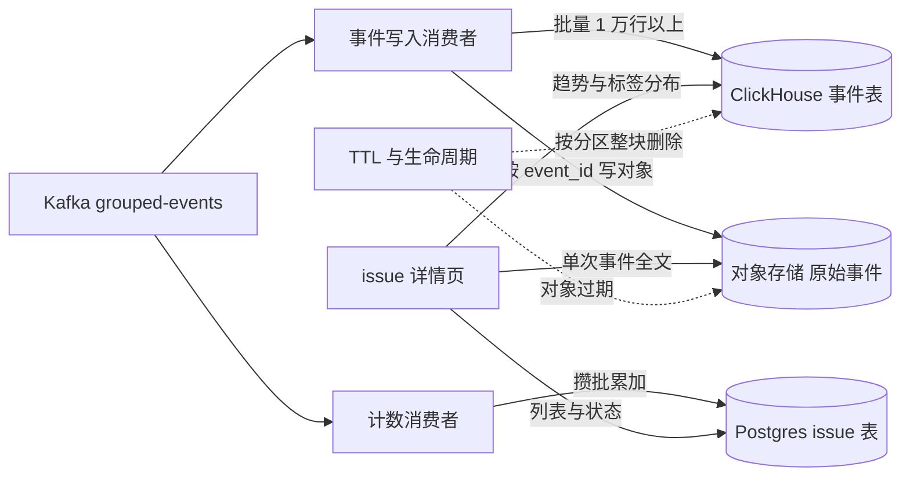

## Q
**issue 表、事件库与保留期**｜完整答案 · 错误追踪与异常聚合（Bugsnag、Sentry） · 必会

面试官：「每天 86 亿个事件，保留 90 天，同时要能按 issue 秒开列表、看趋势图、点开任一次事件的完整堆栈。数据放哪里？怎么按套餐删掉过期数据？」

## A
**一句话。** 三层存储各管一件事：Postgres 存 issue（每个 bug 一行，状态、指派、计数），ClickHouse 存每个事件的可查询字段（时间、issue、release、标签，用于过滤聚合），对象存储存完整原始事件（堆栈、面包屑，按 `event_id` 取）。保留期靠 ClickHouse 按时间分区加 `TTL` 整块删除，对象存储用生命周期规则，Postgres 删除长期不再出现的 issue。

**写入路径。**


**步骤。**
1. **issue 表：** 主键 `issue_id`，唯一键 `(project_id, fp_hash)`，按 `project_id` 分片，行数是 bug 数不是事件数。
2. **事件表：**
   ```sql
   CREATE TABLE events (
     project_id UInt64, timestamp DateTime, event_id UUID,
     issue_id UInt64, release LowCardinality(String),
     environment LowCardinality(String), level LowCardinality(String),
     user_id String, message String,
     tags Map(String, String), retention_days UInt16
   ) ENGINE = ReplacingMergeTree
   PARTITION BY (retention_days, toMonday(timestamp))
   ORDER BY (project_id, toStartOfDay(timestamp), issue_id, event_id)
   TTL timestamp + toIntervalDay(retention_days);
   ```
   排序键以 `project_id` 开头，查询总带项目和时间范围，只读相关数据块；`ReplacingMergeTree` 后台合并时按排序键去掉重复 `event_id`。
3. **原始事件：** 键 `events/{project_id}/{date}/{event_id}`，压缩 JSON，详情页按 `event_id` 直接取。
4. **批量写：** 每次插入生成一个 part，小批频繁插入会让后台合并跟不上；消费者攒上万行或几秒再插，或开 `async_insert`。
5. **保留与隐私删除：** 分区键带 `retention_days`，同分区同日到期，表设 `ttl_only_drop_parts = 1` 只丢整个 part 不重写，对象存储前缀按保留期分开，`last_seen` 过期的 issue 由定时任务清理。用户删除请求逐行删很贵，先在查询层按删除表过滤立即不可见，再后台批量 `DELETE` 变更或等分区过期。

**故障。**
- **ClickHouse 慢或宕机：** 消费者停在当前 offset，事件积压在 Kafka（保留几天），issue 计数路径独立不受影响。
- **重复写入：** 至少一次投递会重插，`ReplacingMergeTree` 合并后去重，需要精确时加 `FINAL` 或按 `event_id` 去重计数。
- **对象写了 ClickHouse 没写（或相反）：** 两边按 `event_id` 幂等，重放补齐；详情页取不到对象显示「原始数据已过期或缺失」。
- **大租户把分片写热：** 排序键以 `project_id` 开头使大租户集中，对其按 `(project_id, 哈希)` 再拆分片。

**为什么这样。**
- 事件不进 Postgres：几十亿行、任意标签聚合，行存储扫描和索引撑不住。
- 完整事件不进 ClickHouse：堆栈和面包屑又大又只在详情页用，放对象存储便宜得多。
- 不用 Elasticsearch 存全部：倒排索引对「按标签计数、画趋势」不如列式库省空间，全文检索需求很小。
- 不逐行删过期数据：列式库的删除是重写数据片，整分区删几乎免费。

**数字。** ClickHouse 每行压缩后约 200 B，约 1.7 TB/天，90 天两副本约 310 TB；对象存储每事件约 5 KB、约 43 TB/天、90 天约 3.9 PB，是最大的成本项，所以采样和按套餐保留直接决定账单。
