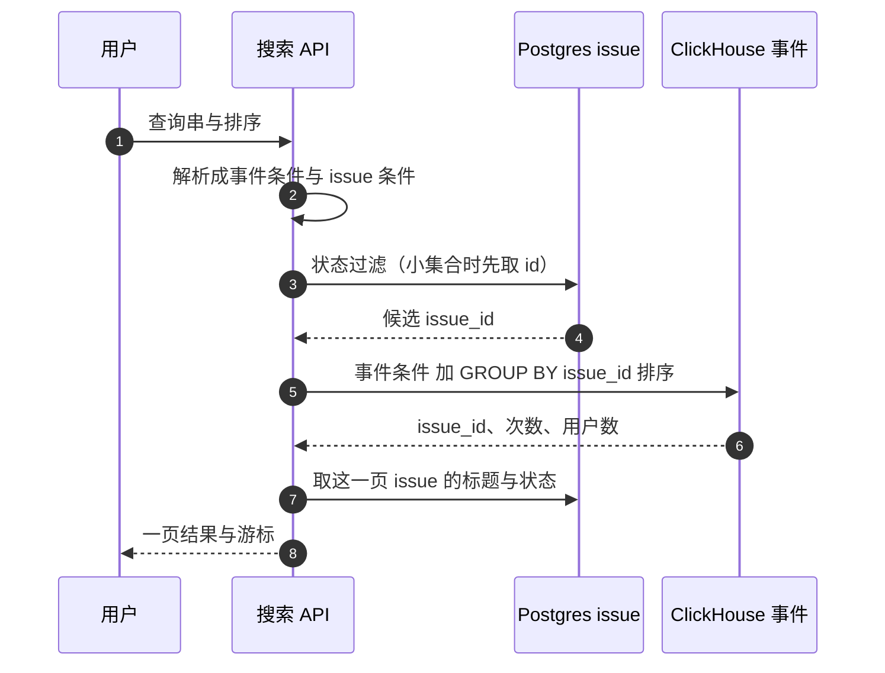

## Q
**issue 搜索：先在事件库过滤聚合，再回 issue 表**｜完整答案 · 错误追踪与异常聚合（Bugsnag、Sentry） · 追问

面试官：「用户在 issue 列表里输入 `is:unresolved release:1.4.2 browser:Chrome user.email:*@acme.com`，按最近 24 小时次数排序。这个查询怎么执行？」

## A
**一句话。** 查询解析成两部分：事件维度的条件（release、标签、用户、时间、消息关键词）下推到 ClickHouse，按 `issue_id` 分组聚合出次数、用户数、最后出现时间并排序；issue 维度的条件（状态、指派、书签）在 Postgres 过滤。两边按 issue_id 求交，再分页返回。

**查询流程。**


**步骤。**
1. **解析：** 语法 `key:value`，支持否定、通配、比较（`times_seen:>100`）；每个 key 归类到事件字段、标签或 issue 字段。
2. **选执行顺序：** 如果 issue 条件很窄（如「指派给我」只有几十个），先在 Postgres 取出 id 列表，作为 `issue_id IN (…)` 下推到 ClickHouse；否则先在 ClickHouse 聚合，再用 Postgres 过滤状态。
3. **ClickHouse 聚合：**
   ```sql
   SELECT issue_id, count() AS n, uniq(user_id) AS users, max(timestamp) AS last
   FROM events
   WHERE project_id = 42 AND timestamp > now() - INTERVAL 1 DAY
     AND release = '1.4.2' AND tags['browser'] = 'Chrome'
     AND tags['user.email'] LIKE '%@acme.com'
   GROUP BY issue_id ORDER BY n DESC LIMIT 100;
   ```
   排序键前缀 `(project_id, 时间)` 让它只读一个项目、一天的数据；`uniq` 是近似去重计数（类似 HyperLogLog），用户数不要求精确。
4. **关键词搜索：** 消息上建跳数索引（skip index）`tokenbf_v1` 或 `ngrambf_v1`，用布隆过滤器跳过一定不含该词的数据块；不必上全文搜索引擎。
5. **高频标签：** 常用的标签（browser、os、release）从 `Map` 提成独立的 `LowCardinality` 列，过滤和压缩都更好。
6. **分页：** 排序值加 `issue_id` 作为游标（keyset pagination），不用深 `OFFSET`。
7. **标签分布页：** 单个 issue 的「各浏览器占比」用同一张表 `GROUP BY tags['browser']`，按 issue 和时间范围裁剪。

**故障与处理。**
- **超大租户扫描太慢：** 查询设超时和最大扫描行数；长时间范围用按小时预聚合的物化视图（`issue_id, hour, count, uniq 状态`），趋势图读预聚合表。
- **一个租户的重查询拖慢别人：** ClickHouse 按租户设查询配额和并发上限；大租户分到独立集群或分片。
- **两边数据不同步：** issue 刚改成已解决，ClickHouse 不知道状态，所以状态永远以 Postgres 为准，最后一步回 Postgres 过滤。
- **刚到的事件搜不到：** ClickHouse 写入有几秒攒批延迟，列表上说明「数据延迟约几秒」，可以接受。
- **采样后的次数：** 事件被采样存储时，每行带权重（如 1/采样率），计数用 `sum(weight)`，保证次数可解释。

**为什么这样，不那样。**
- **不把所有事件放进 Elasticsearch：** 主要需求是「过滤后按 issue 计数排序」，列式聚合更快、存储更省；倒排索引存几十亿事件很贵。
- **不在 Postgres 上建标签索引：** 标签组合任意，事件行数巨大，索引写放大不可承受。
- **不把 issue 状态复制进事件表：** 状态频繁改，复制会导致大量更新；保持事实在一处。

**数字。**
- **每次查询：** 限定项目和时间，扫描量通常是单个项目一天的数据；超时设几秒到十几秒。
- **预聚合：** 按小时一行每 issue，行数比原始事件小几个数量级。
