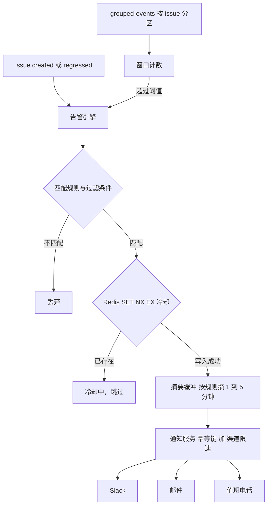

## Q
**告警：规则、去重与通知限速**｜完整答案 · 错误追踪与异常聚合（Bugsnag、Sentry） · 必会

面试官：「客户配了三条规则：新 issue 就发 Slack；已解决的又出现就打电话给值班；某个 issue 一小时超过 1000 次就发邮件。一个坏版本一分钟内产生 50 个新 issue、每个几万次。怎么保证该发的都发、又不把值班的人轰炸死？」

## A
**一句话。** 告警引擎消费 `grouped-events` 和 issue 状态变化事件，规则分两类：状态类（新建、回归）由 upsert 的结果直接触发，天然只有一次；频率类（N 次每 M 分钟）在按 issue 分区的消费者里用滑动窗口计数。每次触发前用 Redis `SET alert:{rule}:{issue} 1 NX EX <冷却秒数>` 去重，冷却期内不再发；同一规则短时间触发很多 issue 就合成一条摘要（digest）。通知服务带幂等键投递、按渠道限速。

**流程。**

**步骤。**
1. **状态类：** upsert 告诉我们「这次是新插入」或「resolved 变成 regressed」，写入 `issue-state` 主题，引擎订阅；唯一键和条件更新保证只发生一次，所以不会重复告警。
2. **频率类：** `grouped-events` 按 issue 分区，同一 issue 的计数在一个消费者内存里，按分钟分桶的滑动窗口（如 60 桶）累加超阈值触发，计数周期性写 Redis，重启后恢复；规则可按环境、级别、标签过滤。
3. **冷却与摘要：** 触发前 `SET alert:{rule_id}:{issue_id} 1 NX EX 1800`，成功才继续，冷却时长即规则的「动作间隔」；同一规则的触发先攒 1–5 分钟，多于一个 issue 就合成「过去 5 分钟有 50 个新 issue，前 5 个是…」。
4. **投递：** 幂等键 `(rule_id, issue_id, 窗口起点)`，失败退避重试，每个 Slack 工作区、邮箱、电话渠道单独限速，超额合并或降级到更便宜的渠道；回归和新 issue 的告警带 `first_release` 和可疑提交。

**故障。**
- **告警引擎崩溃：** 未提交 offset 的事件重放，冷却键和投递幂等键让重放不产生第二条通知；Redis 冷却键因主从切换丢了，最多多发一次，投递幂等键再挡一层。
- **渠道故障（Slack 5xx）：** 退避重试，超上限进死信队列并在应用内通知显示，不影响其他渠道。
- **处理积压使告警晚到：** 监控事件时间到通知时间的 p99，积压严重时优先消费 `issue-state`，频率类晚一点无妨。
- **告警风暴：** 坏版本产生大量新 issue，摘要合并加每项目每分钟通知上限，超出部分只在摘要里计数。
- **突增保护丢了事件使频率规则少算：** 频率计数用接入层「接受 + 丢弃」总数，或按采样权重放大，避免限流反而不告警。

**为什么这样。**
- 不每个事件判断一次「是否新 issue」：并发下会重复，由数据库唯一键决定只发一次。
- 不用定时任务扫库算频率：延迟高且扫几十亿行，流式按 issue 分区计数又准又快。
- 冷却不放通知服务：它不知道规则语义，引擎里按（规则，issue）去重最直接。

**数字。** 冷却常见 5 分钟到 1 天、默认如 30 分钟；摘要窗口 1–5 分钟，在及时和不轰炸之间取舍；新 issue 告警 p99 目标约 1–2 分钟。
