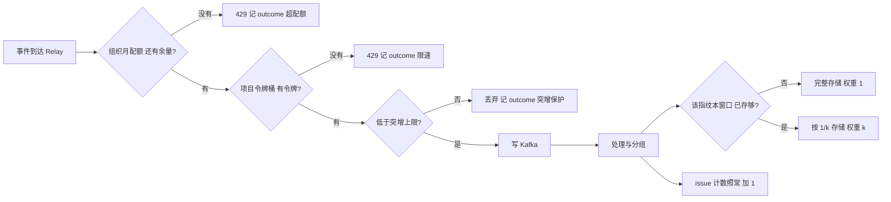

## Q
**突增保护、采样与多租户配额**｜完整答案 · 错误追踪与异常聚合（Bugsnag、Sentry） · 必会

面试官：「一个客户发了个坏版本，它的上报从每秒 200 涨到每秒 20 万，持续一小时。按月配额它两小时就用完；我们的集群也会被它挤满。怎么保护其他租户，同时让这个客户仍然看得到这个 bug、看得到真实规模？」

## A
**一句话。** 在接入层 Relay 执行三道闸：每租户令牌桶限速、按近期基线自动算出的突增上限（spike protection）、按月配额；超出的事件当场丢弃但按类别计数（outcome），客户能看到接受多少、丢弃多少。处理层再对同一指纹动态采样：每个 issue 前若干个事件全存，之后按比例存，计数照常累加。集群层让大租户落在独立分区或洗牌分片（shuffle sharding）上，互不拖累。

**三道闸。**

**步骤。**
1. **令牌桶与突增上限：** 每项目一个桶，容量是允许突发、补充速率是每秒上限，Redis Lua 原子补令牌再扣，Relay 也可先在本地按分到的份额扣并定期对账；突增上限由后台任务按过去若干天同一时段每分钟事件数算出基线，取基线若干倍（且不低于下限），新项目用套餐默认值，写进项目配置，Relay 几秒拉一次。
2. **月配额：** 组织级计数器按事件类型分开，Relay 从中心批量预留一小块（如 1000 个）本地扣、用完再领，用完后按套餐丢弃或转按量计费。
3. **计数与 SDK 配合：** 每个被接受、限速、突增丢弃、超配额的事件按（项目，分钟，原因）聚合写 `outcomes` 主题，客户在用量页看得到被丢多少，频率告警也用总量；429 的 `Retry-After` 让 SDK 在这段时间直接在客户端丢，省双方带宽。
4. **动态采样：** 处理层对每个指纹按时间窗口计数，前 N 个全存，之后只存 1/k，存下的行带 `weight = k`；`times_seen` 仍每个事件加 1，图表用 `sum(weight)`。
5. **租户隔离：** 普通租户按 `project_id` 哈希到共享分区，大租户分专属分区和消费者组；洗牌分片让每个租户随机落在 8 个 worker 里的 2 个，一个租户的风暴只拖慢少数 worker；每租户 ClickHouse 查询设并发和扫描上限。

**故障。**
- **Redis 不可用：** Relay 退回本地限速（按实例数平分上限），fail-open，宁可短暂超额也不拒绝所有租户。
- **基线被污染：** 上周若也有事故基线会偏高，基线取中位数并设上限，客户也可手动设固定上限；合法增长被误伤时只丢超出部分、计数可见，客户可调高或关闭。
- **采样丢掉关键样本：** 每个新 issue、新 release 的前 N 个全存，带用户反馈或手动上报的不采样。

**为什么这样。**
- 不在处理层限流：那时字节已付过带宽和 Kafka 存储，入口丢最便宜。
- 不只用固定上限：小项目固定上限太高不起保护作用，大项目太低天天误伤，基线随项目自适应。

