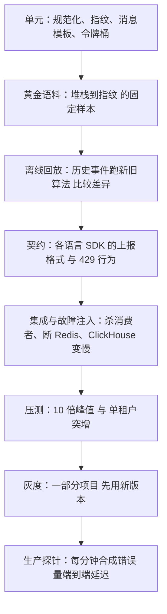

## Q
**怎么测试这个错误追踪系统**｜完整答案 · 错误追踪与异常聚合（Bugsnag、Sentry） · 追问

面试官：「你上线了一个新的分组算法，或者改了接入层的限流。怎么在上线前知道它没有把客户的 issue 拆散、合错，或者把正常流量限掉？上线后又怎么知道整条链路是好的？」

## A
**一句话。** 按风险分层测：分组和符号化这类纯函数用「黄金语料」做回归测试，算法变更先在历史事件上离线回放、比较合并和拆分的数量；接入和流水线用契约测试、故障注入和压测；生产上用合成事件做端到端探针，持续量「上报到出现在 issue 列表、到告警」的延迟，并对新版本灰度发布、对比关键指标。

**测试分层。**

**步骤。**
1. **单元测试：** 帧规范化（行号、地址、lambda 编号被去掉）、in-app 判定、消息模板化、指纹稳定性（同输入同输出，跨进程跨版本不变，所以不能用语言内置的随机化哈希）、令牌桶在边界时间的行为（注入假时钟）。
2. **黄金语料：** 收集几千个真实（脱敏）堆栈，覆盖各语言和各种边角：递归溢出、全是库帧、无堆栈、异步堆栈、混淆名。每个样本标注「应和谁同组」。改动后跑一遍，任何指纹变化都要人审。
3. **离线回放：** 新分组算法在过去一周的事件样本上跑，与旧算法比较：多少旧 issue 被拆开（split）、多少被合并（merge）、新 issue 数会增加多少。拆分率超过阈值就不发布；这也决定迁移期需要多少旧指纹映射。
4. **符号化测试：** 每种调试文件格式一组固定的「压缩堆栈 + 调试文件 → 期望源码帧」；测调试文件晚到的重处理和合并。
5. **SDK 契约测试：** 每个语言的 SDK 对着一个假的接入服务跑：批量格式、gzip、`event_id` 唯一、遇到 429 在 `Retry-After` 期间不再发、崩溃落盘后下次启动重发。
6. **故障注入：** 在预发环境杀掉处理 worker、让 Redis 不可用、让 ClickHouse 变慢、让 Kafka 一个 broker 下线。断言：接入层仍然返回 200 或 429（不出现大量 5xx）；恢复后没有丢事件（按 `event_id` 对账）；没有重复告警。
7. **压测：** 用录制的真实事件放大到 10 倍峰值；再单独模拟一个租户 1000 倍突增，断言其他租户的端到端延迟不变、突增租户的 outcome 计数正确。
8. **灰度：** 新的分组或限流版本先给一部分项目（或影子模式只计算不生效），对比新旧版本的新 issue 速率、拒收率、告警量，异常自动回滚。
9. **生产探针：** 每个区域每分钟用真实 SDK 发一个带唯一标记的合成错误，测量到出现在搜索结果、到告警送达的时间；超过目标就告警。同时监控每个阶段的 Kafka 消费延迟、丢弃率、未符号化比例。

**故障与处理（测试本身）。**
- **黄金语料过时：** 新语言或框架的堆栈不在语料里。每次出现「客户手动合并或拆分」都把样本加回语料。
- **回放用的历史数据含隐私：** 只用脱敏后的样本，在隔离环境跑。
- **合成探针本身被限流：** 探针项目设白名单配额，并单独标记，不计入任何客户统计。

**为什么这样，不那样。**
- **不只靠端到端测试：** 分组错误是「统计上的」，单条事件看不出来，必须在大样本上比较新旧结果。
- **不直接全量上线分组改动：** 一次指纹变化会让所有客户收到海量「新 issue」告警，无法撤回。
- **不只看服务可用性：** 接入返回 200 不代表事件到了 issue 列表，要量端到端延迟。

**数字。**
- **探针频率：** 每区域每分钟一次，足以在几分钟内发现链路中断。
- **回放样本：** 一周、按项目分层抽样，覆盖小项目和大项目。
