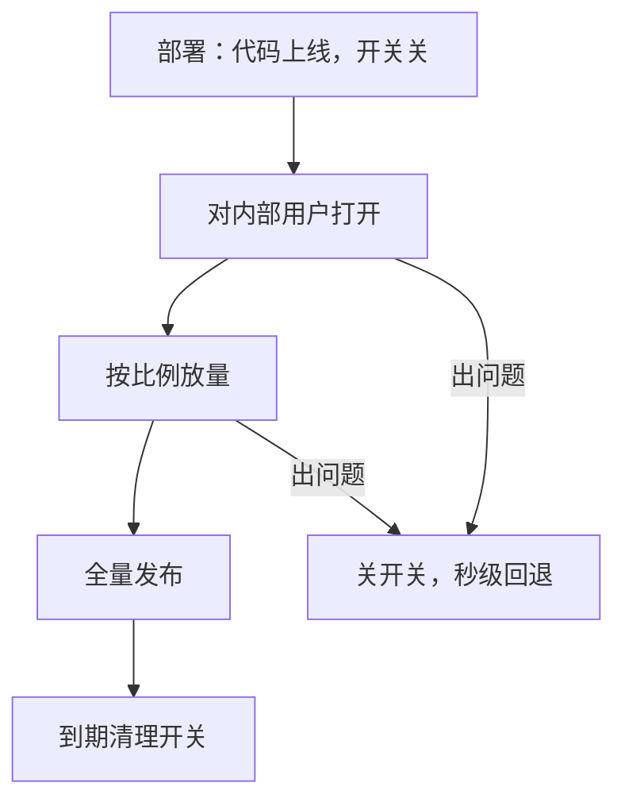

## Q
**功能开关：部署不等于发布**｜补充 · 平台基础设施：容器、服务网格、发布 · 追问

面试官：「功能开关到底解决什么问题？用多了又会带来什么代价？」

## A
**结论。** 它把部署（代码到了生产，但不生效）和发布（行为对用户可见）分开。上线变成日常、低风险的动作；暴露范围成了按人群决定的运行时决策；回退是关开关，不是重新发布。代价是过期的开关会让未经测试的代码路径组合成倍增加。

**要点。**
- **部署与发布分离：** 代码先带着关闭的开关上线，之后按人群、按比例打开。

- **熔断式开关：** 出问题时一键关闭，秒级生效，不用等一次完整的发布流水线。
- **2026 亮点：** 关键二进制里的新逻辑一律放在特性开关后面且默认关闭，并配 kill switch：全局复制的配置或策略数据（比如带空字段的策略变更）几秒内就会传遍所有区域，新代码路径若没有开关、没有错误处理，会在每个区域同时崩溃循环。依赖的检查失败时，要事先定好 fail-open 还是 fail-closed。取舍：开关越多组合越多，要登记到期时间。
- **与灰度的关系：** 灰度分流的是请求到哪个版本，开关控制的是同一版本里哪些行为可见。
- **代价：** 每个开关都是一个分支，N 个开关就有 2 的 N 次方种组合，大多没人测过。

**为什么。** 把发布的风险从「新版本上线」转移到「开关打开」，后者可以按小范围、可逆地进行。

**面试里这样说。** 「新功能我带开关部署，先对内部用户打开，再按比例放量，出问题关开关就退。每个开关登记负责人和到期时间，到期必须清理。」

**易错。**
- **开关永不清理：** 一年后没人知道哪些开关还在用，组合爆炸。
- **用开关做长期的配置分支：** 两套逻辑长期并存，测试和排障都翻倍。
