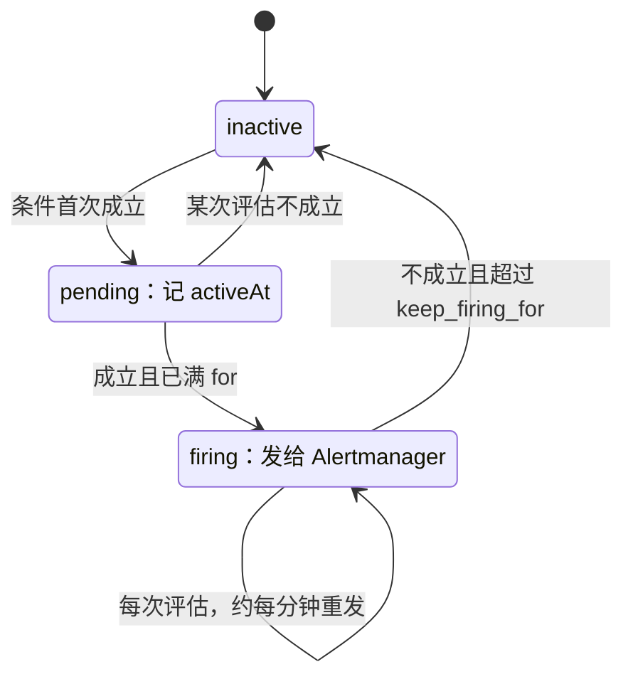

## Q
**告警规则的 for 状态：pending、firing 与重启后恢复**｜补充 · 可观测性 · 追问

面试官：「规则是"5xx 比例 > 5% 持续 5 分钟"。Prometheus 怎么数这 5 分钟？数到第 4 分钟时进程重启，计时会归零吗？条件抖动一下就恢复，会不会反复告警？」

## A
**结论。** 每次评估，表达式返回的每个序列都是一个告警实例，各自走状态机：条件第一次成立进入 pending 并记下开始时间 `activeAt`；之后每次评估仍成立，且 `now − activeAt ≥ for`，就进入 firing。Prometheus 把每个活跃告警的 `activeAt` 作为样本写成 `ALERTS_FOR_STATE` 序列，重启后读它恢复计时，宕机的那段时间不计入。

**要点。**
- **按评估点计数：** 状态只在评估时更新。`for: 5m`、评估间隔 1 分钟，最早在条件成立后的第 5 到 6 次评估才 firing；中间任何一次不成立就回到 inactive，计时清零。
- **两条合成序列：** `ALERTS{alertname, alertstate="pending"|"firing", …}` 值为 1，用来画图、做告警的告警；`ALERTS_FOR_STATE{alertname, …}` 的值是 `activeAt` 的 Unix 时间戳，专门用于恢复。
- **重启恢复：** 启动后第一次评估时，对仍然成立的告警查回 `ALERTS_FOR_STATE`。上次记录距今超过 `--rules.alert.for-outage-tolerance`（默认 1 小时）就不恢复、重新计时；否则把 `activeAt` 向后挪一个"宕机时长"，相当于宕机的时间不算数。
- **宽限期：** 恢复后若离 firing 只剩一点点，Prometheus 至少再等 `--rules.alert.for-grace-period`（默认 10 分钟），以免刚启动、数据还不全就误报；只对 `for` 比宽限期长的规则生效。
- **防抖：** `keep_firing_for` 让告警在条件最后一次成立后继续保持 firing 一段时间，抖动一下不会立刻恢复又再次触发。
- **重发：** firing 期间 Prometheus 按 `--rules.alert.resend-delay`（默认 1 分钟）把告警重发给 Alertmanager，带一个 `endsAt`；停止发送后，Alertmanager 到 `endsAt` 就认为它已恢复。

**为什么。** 计时状态如果只在内存里，任何一次部署都会让长 `for` 的告警重新数，严重故障可能因此晚报；写回时序库就把这份小状态持久化了。

**面试里这样说。** 「每个告警实例在评估时走 inactive、pending、firing。pending 的开始时间写进 ALERTS_FOR_STATE，重启时读回来，宕机时间不算；短抖动用 keep_firing_for 压住。」

**易错。**
- **以为 for 是"5 分钟内多数时间成立"：** 中间任何一次评估不成立都会清零。
- **规则改了标签：** 恢复按标签匹配，标签变了就当成新告警重新计时。
