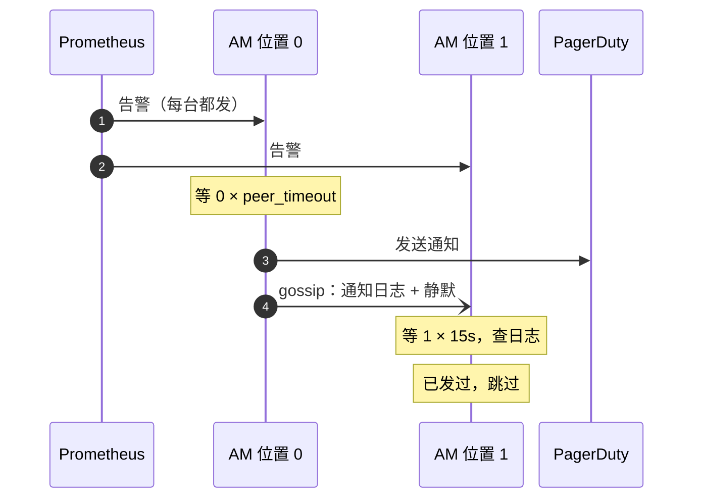

## Q
**Alertmanager 高可用：每台都收全量告警，用八卦协议去重**｜补充 · 可观测性 · 追问

面试官：「三台 Alertmanager 做高可用。Prometheus 该发给其中一台，还是每台都发？三台都收到同一个告警，值班人会不会收到三条？它们之间网络断了呢？」

## A
**结论。** Prometheus 把告警发给每一台，不经过负载均衡；三台各自分组、各自准备发送，但按集群里的位置错开等待，先发的那台把"已通知"记进通知日志，通过八卦协议（gossip，节点之间随机互传消息、最终人人都知道）同步给其他两台，后面的看到记录就不再发。网络断开时，它们各自都会发，宁可重复也不漏。

**要点。**
- **为什么每台都发：** 每台必须都有全量告警，才能在别人挂掉时接着发。官方明确要求不要在 Prometheus 和 Alertmanager 之间放负载均衡，而是列出全部地址。
- **共享的状态：** 集群用 memberlist（一个 gossip 库）在 `--cluster.listen-address`（默认端口 9094，TCP 和 UDP 都要通）上同步两样东西：通知日志（哪个分组、什么内容、何时发给了哪个接收方）和静默（silence）。告警本身不同步，靠 Prometheus 各发一份。
- **错开等待：** 每台按自己在成员列表里的位置等 `位置 × --cluster.peer-timeout`（默认 15 秒）再发；位置 0 的立刻发，位置 1 的等 15 秒，那时通常已经从 gossip 里看到位置 0 的发送记录。
- **一台挂了：** 位置 0 不发了，位置 1 等完 15 秒查不到记录就自己发，最多晚 15 秒。
- **网络分区：** 互相看不到对方的通知日志，各自发送，值班人可能收到重复。这是有意选择的可用优先：告警系统漏报比重复更糟。PagerDuty 等接收方再按 `dedup_key` 合并成一个事件。
- **新节点加入：** 启动时等待集群状态收敛（settle）后再评估通知，避免刚起来、还没拿到通知日志就重复发。

**为什么。** 告警发送需要的状态很小（发过什么、谁被静默），用最终一致的 gossip 就够了，不必为它引入共识协议；多发一次的代价远小于漏发。

**面试里这样说。** 「Prometheus 直接发给每一台 Alertmanager。它们用 gossip 共享通知日志和静默，按位置错开 15 秒发送，正常只发一次；分区时会重复，接收方按 dedup_key 合并。」

**易错。**
- **在前面放负载均衡：** 每台只拿到部分告警，挂一台就丢一部分。
- **以为 gossip 保证只发一次：** 它只降低重复，分区和切换时仍会重复。
