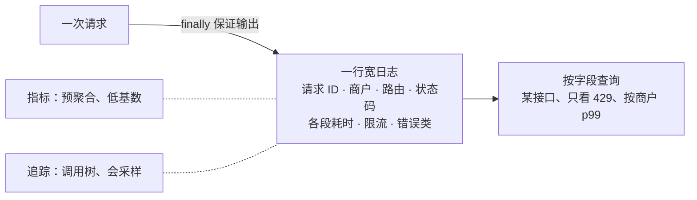

## Q
**一请求一行宽日志（canonical log line）**｜补充 · 可观测性 · 追问

面试官：「线上排查时，为什么一次请求只输出一行包含所有信息的结构化日志，比到处散落的多行日志好用？这行日志应该有什么？」

## A
**结论。** 请求结束时输出一行结构化日志，装下关于这次请求的全部事实：请求 ID、认证主体、路由、状态码、各段耗时、限流决策、错误类别。排查变成对这些字段的查询，而不是拼凑碎片。

**要点。**
- **包含什么：** 请求 ID、商户或用户、路由与方法、状态码、总耗时、数据库耗时、外部调用耗时、限流结果、错误类。
- **为什么宽：** 所有字段在同一行，可以像查 SQL 一样过滤和聚合，例如某接口最近一小时、只看 429、按商户的 p99。
- **散落日志的问题：** 同样的问题要靠请求 ID 拼接片段，还要赌需要的字段刚好打过。
- **和指标的分工：** 指标是预聚合、低基数、便宜，但钻不到单个请求。
- **和追踪的分工：** 追踪展示调用树，但会采样且较重；宽日志每个请求都有、便宜、可查询，是两者的中间层。

**为什么。** 高基数的细节（用户、商户、请求）不适合放指标，适合放进每请求一行的日志里按需查询。

**面试里这样说。** 「每个请求结束时我只输出一行结构化日志，带请求 ID、商户、路由、状态码和各段耗时。这样排查就是一次查询：这个接口昨天哪些商户 p99 超标、是不是都在 429。」

**易错。**
- **每个字段单独打一行：** 排查要拼接，字段缺失。
- **把用户 ID 放进指标标签：** 基数爆炸，应放在日志里。
- **请求失败的路径没有输出：** 最需要的日志恰好丢了，要用 finally 保证输出。
