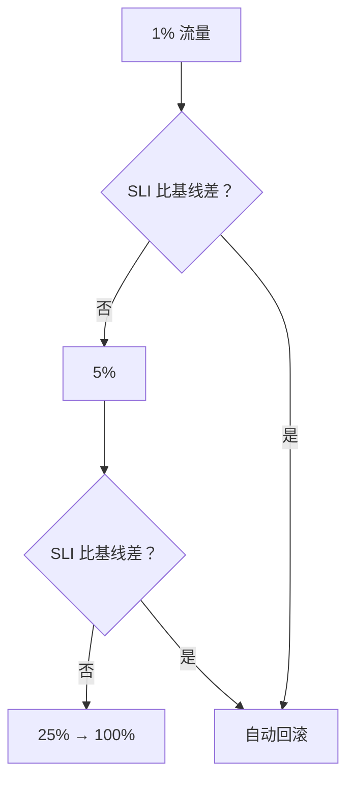

## Q
**滚动、蓝绿、金丝雀怎么选**｜补充 · 可靠性 · 必会

面试官：「新版本要上线。滚动发布、蓝绿发布、金丝雀发布各自优化什么？哪一种真正能在全量之前验证新版本？」

## A
**结论。** 滚动省资源但回滚最慢，蓝绿回滚最快但要双倍容量、且全量用户同时暴露，金丝雀是唯一用真实流量先验证再放量的。常见默认是金丝雀验证，加蓝绿式的一键回滚。

**要点。**
- **滚动：** 分批替换实例，不需要备用机队；新旧版本混跑一段时间，回滚要再滚一遍，最慢。
- **蓝绿：** 整套机队复制一份，原子切流量；回滚就是切回去，最快，没有版本混跑。代价是双倍容量，且切换后 100% 用户同时碰上坏版本。
- **金丝雀：** 先放 1%、5%、25%、100%，同时拿新版本的 SLI 和基线比。只有它能在全量前用真实流量验证。

- **自动判定：** 金丝雀必须配自动指标对比和自动回滚，否则只是走流程。
- **版本共存：** 三种都会让两个版本同时在线，数据库结构和接口要向前向后兼容。
- **2026 亮点：** 三种策略管的不只是代码：配置、策略数据的下发同样要分批加回滚，因为全局复制的元数据几秒内就传遍所有区域；新代码路径先放 feature flag 后逐区域打开，再留一个能关掉该路径的「红按钮」并提前演练（2025 年 6 月谷歌那次事故里红按钮约 40 分钟才推完），坏数据要能 fail-open 或降级而不是崩溃。代价是流程更慢，开关要登记和回收。

**为什么。** 三种策略的差别在两件事：多快能撤回，多少用户先承担风险。蓝绿解决前者，金丝雀解决后者，所以组合使用。

**面试里这样说。** 「我默认走金丝雀，1%、5%、25% 逐级放量，每级自动比对错误率和延迟，退化就自动回滚；回滚路径保留蓝绿式的整体切回，保证几分钟内撤得掉。」

**易错。**
- **金丝雀没有自动对比：** 靠人盯面板，坏版本多放量几级才发现。
- **蓝绿后立刻删旧环境：** 回滚能力没了。
- **忽略版本共存：** 新旧版本同时读写同一张表，兼容性问题在发布中途爆发。
