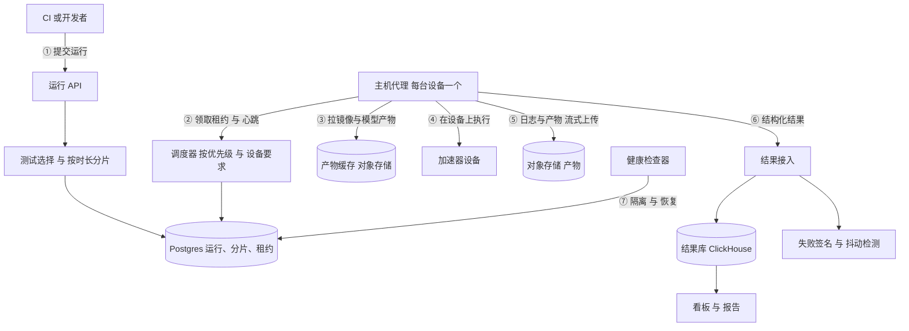

## Q
**全景**｜完整答案 · 测试执行平台（稀缺硬件上的大规模测试） · 必会

面试官：「我们是做 AI 加速器的公司。每天有几千个测试要在真实硬件上跑，但整机只有大约 200 台，又贵又稀缺。设计一个测试执行平台：开发者提交代码要跑预提交测试，每晚跑全量，发版前跑发布资格测试。从需求讲到深挖。」

## A
**先说清几个词。**
- **加速器：** 做神经网络矩阵运算的芯片或整机（GPU、TPU、Cerebras 晶圆级系统），对测试平台就是「很贵、很少、偶尔会坏的被测设备」。
- **编译与加载：** 把神经网络（计算图加几十 GB 权重）翻译成芯片能执行的程序再装进去，要几分钟到几十分钟，是测试里最贵的准备步骤。
- **推理与评测（eval）：** 推理是用模型算结果，评测是在一组题上跑模型并与参考输出（golden output）比，判断精度有没有回退。

**一句话。** 平台是「稀缺设备上的批处理系统」：测试请求进调度器，按优先级（发布资格 > 预提交 > 夜间）和历史时长切成分片；每台设备由主机代理通过租约领取分片，在固定镜像和固件的密封环境里跑，结果和产物流式上传；结果服务把失败归成失败签名，区分产品失败、测试抖动和基础设施失败；设备中途死掉时租约过期触发重排到别的设备，而不是判测试失败。

**需求。** 提交运行（测试、代码版本、设备要求、优先级）、调度执行、收集结果日志产物、失败归类与抖动检测、设备池管理；不做构建系统本身。预提交 p90 等待加执行 30 分钟内；发版候选必须按期跑完资格测试，容量要预留；设备故障不能算产品回归，抖动测试不能阻塞合并；设备是最贵资源，目标忙碌率约 80% 但不牺牲预提交延迟。

**规模。** 200 台设备，每天 4,800 设备小时：

| 类别 | 算式 | 设备小时/天 |
|---|---|---|
| 预提交 | 400 次提交 × 30 个测试 × 5 分钟 | 1,000 |
| 夜间 | 6,000 个测试 × 12 分钟 | 1,200 |
| 发布资格 | 15,000 个测试 × 10 分钟 = 2,500，摊 2 天 | 1,250 |
| 合计 | 3,450 ÷ 4,800 | 约 72%，加重跑、重置、健康检查已近上限 |

**架构。**

**必讲深挖。**
- **租约：** 代理拉取式领活，租约加心跳加纪元号防旧代理回写；设备有健康状态机。
- **调度：** 三类优先级各有预留容量、空闲时互相借用；老化防饿死；只在测试边界抢占。
- **分片：** 按历史时长做最长任务优先（LPT）装箱，加动态领取消除长尾；同模型的测试放同一台设备，减少编译加载。
- **结果：** 失败签名去重；同一提交先过后失败就是抖动；基础设施失败与测试失败分开计。

**为什么这样。**
- 不推送式分配：调度器不知道设备此刻是否健康，代理来领活等于每次证明「我还活着」。
