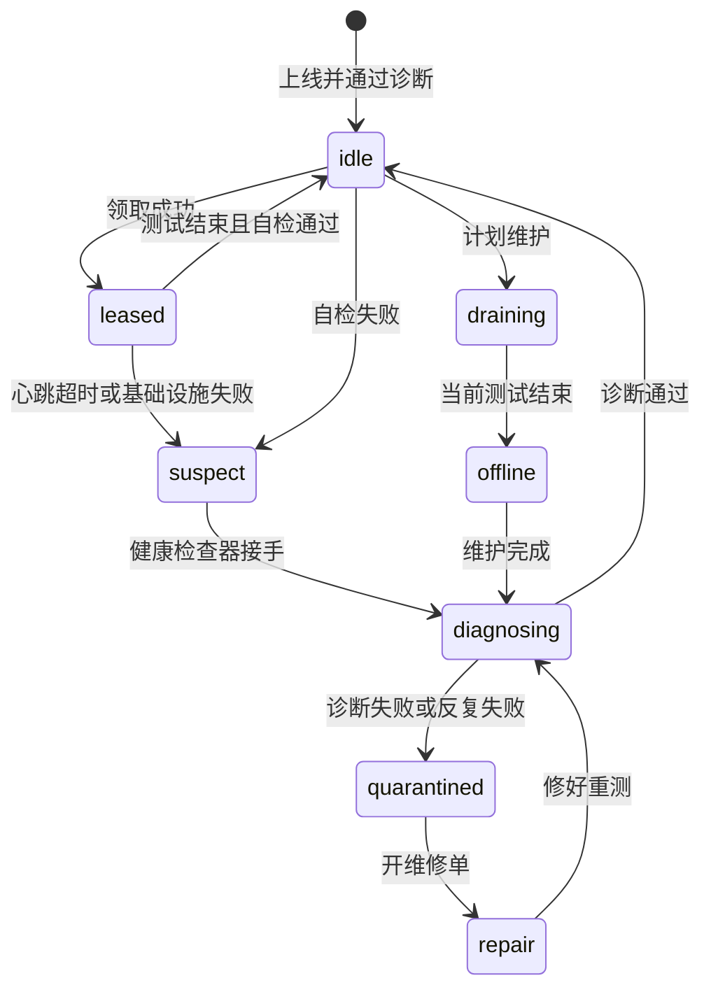

## Q
**设备租约与健康检查**｜完整答案 · 测试执行平台（稀缺硬件上的大规模测试） · 必会

面试官：「200 台设备，每台由一个主机代理管理。怎么保证一台设备同一时刻只跑一个测试？设备坏了、半坏（能跑但结果不对）怎么发现、怎么从池子里拿掉、修好了怎么回来？」

## A
**一句话。** 设备归属记在 Postgres：代理空闲时调用领取接口，调度器用一次条件更新把设备从 `idle` 改成 `leased`，同时写入 `attempt_id`、自增的 `lease_epoch` 和 `lease_until`；代理每 30 秒心跳续约，所有写回都带 `lease_epoch`，旧纪元一律拒绝。设备有健康状态机：测试前快速自检，连续出现基础设施失败就自动隔离、跑完整诊断，通过才回池，修不好转人工维修。

**设备状态机。**


**步骤。**
1. **领取：** 代理带设备属性（型号、固件、内存、机架）调用 `leases:acquire`，调度器选出分片后一个事务里：
   ```sql
   UPDATE device SET state = 'leased', attempt_id = $a,
          lease_epoch = lease_epoch + 1,
          lease_until = now() + interval '90 seconds'
   WHERE device_id = $d AND state = 'idle'
   RETURNING lease_epoch;
   ```
   影响 0 行说明设备已被拿走，换下一台；同事务把分片标 `running` 并写 Attempt。
2. **心跳与完成：** 每 30 秒 `heartbeat(attempt_id, lease_epoch)`，`UPDATE … WHERE lease_epoch = $e` 影响 0 行就告诉代理租约已失效、立刻停止；`complete` 同样以纪元号为条件，把设备改回 `idle` 或 `suspect`。
3. **自检与诊断：** 测试前几秒到一分钟：设备枚举、温度电源读数、跑一个已知输入输出的小程序（golden kernel），失败就报 `suspect` 不接活；健康检查器每分钟扫过期租约，对 `suspect` 设备派完整诊断（内存测试、链路测试、固定小模型推理比对输出）。
4. **自动隔离与维护：** 最近 N 次尝试基础设施失败超阈值，或这台设备上的失败率显著高于同一测试在其他设备上的，自动转 `suspect`；运维设 `draining` 后不再接新活，当前测试结束进 `offline`，不打断正在跑的。

**故障。**
- **代理进程崩溃：** 心跳停止，90 秒后租约过期，检查器把 Attempt 记基础设施失败、分片重排、设备转 `suspect`。
- **分区、GC 停顿、机器卡死后醒来：** 代理续约失败超过租约时长就自己停止测试；迟到的写回纪元号已旧被拒，等价于防护令牌（fencing token）。
- **半坏设备（结果偶尔错）：** 自检只看得到明显故障，靠「同一测试在这台失败、换设备就通过」的统计发现并隔离。
- **大量设备同时变 `suspect`（如固件推送坏了）：** 隔离比例超过阈值（如 10%）就停止自动隔离并告警人工，免得把整个机群隔离掉；检查器多实例用 `FOR UPDATE SKIP LOCKED` 分摊，不需选主。

**为什么这样。**
- 不用 Redis 锁表示归属：设备状态、尝试、分片要在一个事务里改，规模只是几百台设备每秒几次领取，放同一个 Postgres 更简单。
- 不让调度器推送任务：推给刚死的设备要等超时才发现，拉取模式下只有活着的代理才来领。

