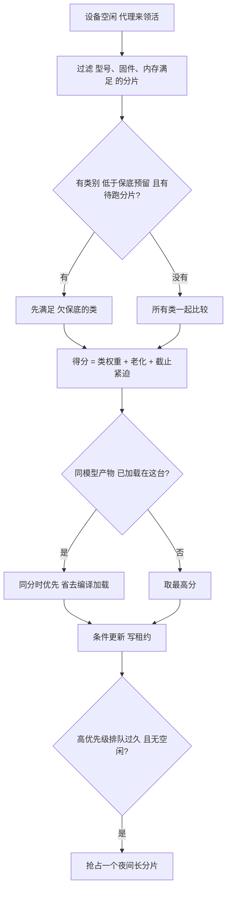

## Q
**优先级调度：发布资格、预提交与夜间**｜完整答案 · 测试执行平台（稀缺硬件上的大规模测试） · 必会

面试官：「晚上 10 点夜间全量刚开始，占满了所有设备；这时发版候选到了，要求明早 8 点前跑完资格测试；第二天早上开发者开始提交代码等预提交结果。调度器怎么决定下一台空闲设备给谁？」

## A
**一句话。** 三个优先级类各有一份保底预留（发布资格在有候选时保底最多，预提交白天保底约一半，夜间没有保底只吃剩余），空闲容量可以借给别的类；设备空闲时，调度器在「能跑在这台设备上」的分片里按得分挑：类别权重 + 等待时间老化 + 截止时间紧迫度；被借走的容量在测试边界归还，只有夜间的长测试在必要时被抢占，并从检查点（checkpoint）续跑或整片重排。

**决策流程。**

**步骤。**
1. **类别与保底：**
   - **发布资格（release-qual）：** 有截止时间。有候选时保底按「剩余设备小时 ÷ 剩余时间」动态计算，保证按时跑完。
   - **预提交（presubmit）：** 开发者在等，看延迟。工作时间保底约 100 台（白天的峰值需求），夜里降低。
   - **夜间（nightly）：** 看吞吐，没有保底，吃剩余容量。
2. **借用：** 某类用不满保底，空闲设备可以分给别的类；保底只在「有待跑分片」时生效。
3. **设备约束先过滤：** 型号、固件版本、内存大小、是否需要多台互联；不满足的分片看都不看。
4. **得分：** `类权重 + α × 等待分钟 + β × 截止紧迫度`，紧迫度 = 剩余所需设备小时 ÷ 剩余时间与当前占用之比；老化让夜间也不会饿死。
5. **亲和：** 同分时优先选「这台设备上已经加载了相同模型产物」的分片，省掉几分钟到几十分钟的编译加载。
6. **公平分享：** 同一类内部按团队或提交者做加权公平（谁最近用得少谁先），防止一个人提交 50 次把预提交队列占满。
7. **抢占：** 只在高优先级等待超过阈值、且没有设备将在几分钟内空出时才抢占；只抢夜间分片，挑「已经跑了最短时间」的那个，损失最小。被抢的分片如果支持检查点就从检查点续跑，否则整片重排，`attempt` 加一但不算失败。
8. **实现：** 待跑分片在 Postgres，按类别和设备型号建索引；领取时 `SELECT … FOR UPDATE SKIP LOCKED` 取候选，算分后条件更新。规模是每秒几次领取，单个调度服务加热备即可。

**故障与处理。**
- **调度器宕机：** 状态都在 Postgres，热备接手；正在跑的测试不受影响，只是新领取暂停几秒。
- **两个调度器实例同时分配同一分片：** 条件更新 `WHERE state = 'queued'` 只有一个成功。
- **发布资格眼看赶不上：** 紧迫度上升，保底自动扩大；再不够就告警发布负责人，同时降级：先跑「必须」级的资格测试，次要的推后。
- **抢占风暴：** 限制每分钟最多抢占几次；被抢过的分片下次有保护期。
- **预提交被大量重试淹没：** 每次提交的重跑次数有上限；抖动测试走隔离通道，不占预提交保底。

**为什么这样，不那样。**
- **不用严格优先级：** 高优先级持续有活时低优先级永远饿死，夜间全量就永远跑不完。
- **不用固定分区（每类固定若干台）：** 夜里预提交的 100 台空着，白天夜间队列又空着，浪费最贵的资源。
- **不随意抢占：** 加速器上一个测试的准备（编译加载）可能占一半时间，抢占等于把这些都扔掉。

**数字。**
- **预提交保底：** 白天约 100 台，来自利特尔法则：每小时 6,000 设备分钟需求 ÷ 60 = 100。
- **发布资格：** 2,500 设备小时要在 10 小时内跑完，需要约 250 台，超过整个机群，所以必须提前开始或分两天，或砍掉部分测试，这正是要在面试里指出的。
- **利用率：** 目标约 80%，留出余量吸收突发；越接近 100%，排队时间增长越陡。
