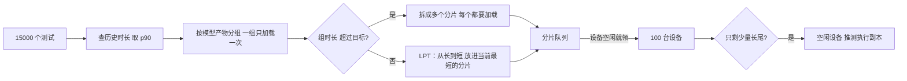

## Q
**按时长分片：LPT 装箱、动态领取与模型亲和**｜完整答案 · 测试执行平台（稀缺硬件上的大规模测试） · 必会

面试官：「一次发布资格有 15,000 个测试，时长从 30 秒到 2 小时不等，有些测试共用同一个模型。你有 100 台设备。怎么切分，让整体最快跑完、设备不空等？」

## A
**一句话。** 用历史时长估每个测试（取近期 p90，没有历史的用同类默认值），先按模型产物把测试分组（同组在同一台设备上只编译加载一次），再用最长任务优先（LPT，Longest Processing Time first）把组装进目标时长约 20–30 分钟的分片；分片放进队列由设备动态领取，而不是事先绑定设备，快的设备多领，慢的少领；最后剩下的长尾分片可以在空闲设备上推测执行（speculative execution）一份副本，先完成的算数。

**分片流程。**

**步骤。**
1. **时长来源：** 结果库里每个 `(test_id, 设备型号)` 最近 N 次成功执行的 p90；新测试用同目录或同类测试的中位数，并标记「估计不准」。
2. **准备成本单独算：** 测试时长 = 准备（拉产物、编译、加载模型）+ 执行。同一模型的测试放在一起，准备只付一次。
3. **装箱：** 把组按时长从长到短排序，每次放进当前总时长最短的分片（LPT）。分片数取 `总时长 ÷ 目标分片时长`，目标 20–30 分钟：太短则准备开销占比高，太长则一台设备坏了损失大、长尾也长。
4. **超长测试：** 单个测试超过目标时长就自成一片；如果能按参数（如不同输入规模）拆开，就拆成独立测试。
5. **动态领取：** 分片进入队列，空闲设备领取；同一型号的设备性能有差异，动态领取天然平衡。
6. **长尾：** 当队列空了、仍有分片在跑且已超过估计时长的 1.5 倍，就在空闲设备上推测执行一份；先完成的结果被采用，另一份取消。
7. **反馈：** 每次执行后更新时长统计；估计偏差大的测试在看板上标出。

**故障与处理。**
- **时长估计错误：** 某个测试突然变慢 10 倍（往往本身就是性能回归）。动态领取会吸收大部分影响；超时上限是 p99 的若干倍，超时记为失败并附「比历史慢 N 倍」。
- **分片中途设备坏：** 只重跑这个分片里没完成的测试，已完成的结果已经流式上报。
- **推测执行的两份都写结果：** 每份是不同的 `attempt`，结果服务只接受分片的第一个终态，第二个标为重复。
- **测试之间有隐藏依赖：** 拆到不同分片后失败。说明测试不密封；修测试，不要靠固定顺序。

**为什么这样，不那样。**
- **不按测试个数平均切：** 时长差几百倍，最慢的分片决定整体完成时间。
- **不用 Bazel 那种静态分片号（`TEST_TOTAL_SHARDS`、`TEST_SHARD_INDEX`）作为唯一手段：** 静态分片在构建时就定死了每片内容，无法适应设备快慢和临时故障；在单个测试目标内部可以用，跨设备调度要动态。
- **不把每个测试单独成一片：** 每片都要付准备成本，模型编译加载可能比测试本身还长。

**数字。**
- **LPT 的保证：** 最坏情况下完成时间不超过最优解的 4/3 − 1/(3m) 倍（m 是机器数），实际通常接近最优。
- **例子：** 15,000 个测试平均 10 分钟 = 2,500 设备小时；100 台设备理想完成时间约 25 小时；目标分片 25 分钟约 6,000 个分片，每台约 60 片，单片失败只损失 25 分钟。
