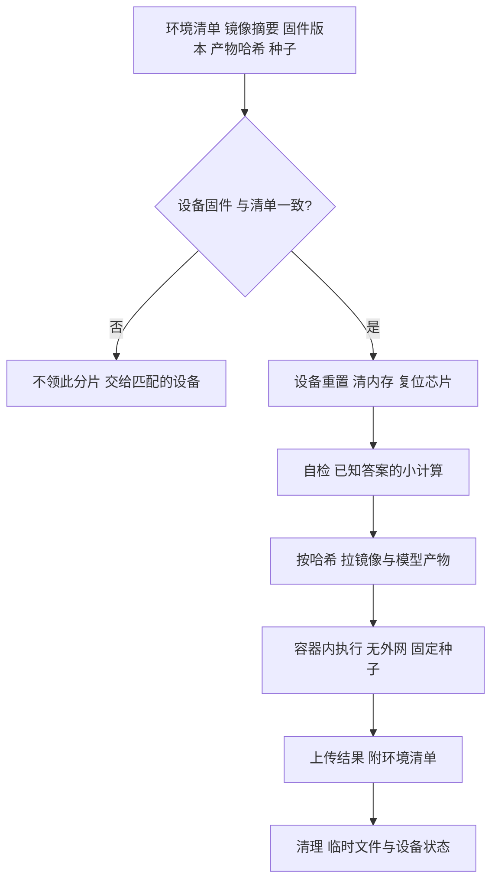

## Q
**密封环境：同样的输入，在哪台设备上都得同样的结果**｜完整答案 · 测试执行平台（稀缺硬件上的大规模测试） · 必会

面试官：「同一个测试，在 A 设备上通过、在 B 设备上失败；上周通过、这周没改代码却失败了。你怎么设计执行环境，让结果只取决于被测代码？」

## A
**一句话。** 每次执行的全部输入都显式声明并按内容寻址：运行时镜像按摘要（`image@sha256:…`）固定，模型权重和数据集按内容哈希从产物缓存拉取，设备固件和驱动版本作为调度约束；测试开始前把设备重置到已知状态，执行时禁止访问外网，随机种子和时间可注入；最后把这套「环境清单」与结果一起存下，任何两次结果的差异都能追到某一项输入的差异。

**执行前后。**

**步骤。**
1. **镜像：** 测试运行时（Python、编译器、驱动用户态库、测试框架）打成容器镜像，运行请求里只写摘要，不写 `latest` 这种会漂移的标签。
2. **产物：** 被测的编译结果、模型权重（几 GB 到几百 GB）、评测数据集都按内容哈希存在产物缓存（对象存储加机架内缓存）；同一哈希只下载一次，校验哈希后使用。
3. **硬件侧版本：** 固件、驱动内核模块、芯片配置无法放进容器，它们成为设备属性；运行请求写明需要的版本，调度器只派给匹配的设备。固件升级按批次滚动，新旧版本并存期间测试明确指定版本。
4. **重置：** 每个分片开始前软复位设备、清空片上内存；连续几次异常后做完整复位或下电重启。
5. **隔离：** 容器只读根文件系统、独立临时目录、无外网（只能访问产物缓存和结果接入），资源限额。
6. **确定性：** 随机种子由平台注入并记录；需要时间的测试用注入的时钟；并行规约（reduction，多个部分和合并成总和）的浮点结果顺序不同会有微小差异，精度测试用容差比较，而不是逐位相等。
7. **清单入库：** 每个结果附带 `{镜像摘要, 固件, 驱动, 产物哈希, 种子, 设备 id}`；看板可以按任一项分组比较失败率。

**故障与处理。**
- **测试偷偷访问外网：** 无外网直接失败，暴露隐藏依赖，修测试。
- **上一个测试留下的状态：** 重置加清理；若某测试只在「某测试之后」失败，说明重置不彻底，把那台设备的重置步骤升级并上报。
- **产物缓存未命中导致拉取几十分钟：** 按即将调度的分片预取；机架内缓存按模型热度保留；拉取时间单独计入「准备」，不算测试超时。
- **固件版本混用：** 调度约束保证不会派错；固件推送中途失败的设备版本不明，自检失败进隔离。
- **浮点不确定导致结果漂移：** 用容差和统计判定（如多次运行的均值在区间内），并把确定性模式下的逐位比较留给专门的确定性测试。

**为什么这样，不那样。**
- **不在长期存活的设备主机上直接装环境：** 主机会慢慢「漂移」（有人手动装了包），同一测试在不同主机上行为不同。
- **不追求硬件侧也放进容器：** 固件和驱动属于设备本身，只能声明并调度匹配。
- **不忽略环境差异只看结果：** 没有清单就无法回答「为什么上周通过」。

**数字。**
- **重置：** 软复位几秒到几十秒，完整下电可能几分钟；要计入准备成本，并用分片尽量摊薄。
- **产物：** 大模型权重几十到几百 GB，按 10 Gbps 拉取 100 GB 约 80 秒以上，所以缓存和亲和调度很重要。
