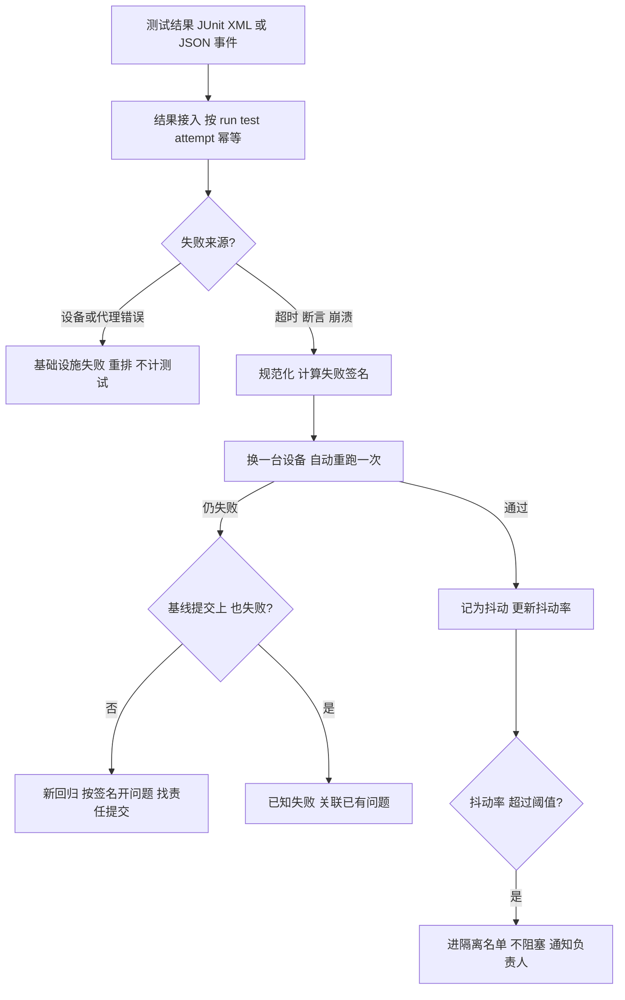

## Q
**结果接入、失败签名与抖动检测**｜完整答案 · 测试执行平台（稀缺硬件上的大规模测试） · 必会

面试官：「昨晚 6,000 个测试里失败了 300 个。值班的人早上只有半小时。你怎么把这 300 个失败变成几条可行动的结论：哪些是真回归、哪些是测试抖动、哪些是设备问题？」

## A
**一句话。** 代理把每个测试的结构化结果流式上报，结果服务按 `(run_id, test_id, attempt)` 幂等写入；每个失败先按来源分类（基础设施、超时、断言、崩溃），再把错误类型 + 规范化后的消息模板 + 项目内栈帧哈希成失败签名，300 个失败通常归成十几个签名；对每个失败在同一提交上自动换设备重跑一次，「失败后又通过」记为抖动；按测试计算滚动抖动率，超过阈值的进隔离名单，照跑但不阻塞合并。

**处理流程。**

**步骤。**
1. **上报：** 代理边跑边发结构化事件（测试开始、结束、状态、耗时、失败消息、栈），并在结束时上传 JUnit XML 作为兜底；日志和大文件走对象存储，只上报链接。
2. **幂等写入：** 结果表主键 `(run_id, test_id, attempt)`，`INSERT … ON CONFLICT DO NOTHING`；只接受带当前 `lease_epoch` 的写入。结果明细进 ClickHouse 供聚合，运行级汇总进 Postgres。
3. **分类：**
   - **基础设施失败：** 代理报告的设备错误、心跳丢失、产物拉取失败、驱动错误码。
   - **超时：** 超过 p99 的若干倍。
   - **断言失败与崩溃：** 测试自身报告的失败。
   规则表维护「哪些错误码属于基础设施」，这是平台和硬件团队共同维护的。
4. **失败签名：** 与错误追踪的指纹同一方法：异常类型 + 消息模板（数字、地址、路径、时间、张量形状里的批大小换成占位符）+ 前几个项目内帧，哈希。精度失败额外把「哪个指标、偏离方向」放进签名。
5. **自动重跑：** 失败的测试在同一提交上、换一台设备重跑一次（每次运行有重跑预算，如最多 5% 的测试）。
6. **判定：**
   - 重跑通过：抖动（flaky），本次不算失败但记一次。
   - 重跑失败，基线提交（上一个绿的版本）通过：疑似回归，用二分（bisect）在两个提交之间找责任提交。
   - 基线也失败：已知问题，关联到已有工单。
7. **抖动率：** 每个测试最近 N 次（如 100 次）在相同代码上的「失败后重跑通过」比例，或结果翻转次数；超过阈值（如 2%）进隔离名单，开工单给负责人，修好且连续通过一段时间后自动解除。

**故障与处理。**
- **代理重复上报：** 主键幂等，重复丢弃。
- **旧租约的迟到结果：** 纪元号不符，拒绝。
- **签名过粗，把两个不同问题合在一起：** 消息模板保留关键常量（错误码、算子名）；值班人员可以拆分，拆分规则回写到签名配置。
- **把真回归误判成抖动：** 一个会间歇失败的真 bug（如竞态）也会「重跑通过」。隔离不是删除：隔离名单里的测试照跑，抖动率突然上升或在某个提交之后上升，按回归处理。
- **重跑吃掉太多设备：** 重跑预算有上限；某次运行失败率异常高（如设备批量故障）时停止自动重跑，先查基础设施。

**为什么这样，不那样。**
- **不逐个看失败：** 300 个失败往往是十几个原因；签名先去重，值班只看签名。
- **不把重跑通过的直接当正常：** 不记录的话抖动永远修不好，平台的信号越来越不可信。
- **不把隔离的测试关掉：** 关掉等于失去覆盖；照跑但不阻塞，保留数据。

**数字。**
- **去重效果：** 300 个失败归成十几个签名是常见量级，值班的人只需处理签名。
- **重跑预算：** 每次运行最多约 5% 的测试可重跑；预提交上每个测试最多重跑一次。
- **抖动阈值：** 如 100 次里失败后重跑通过超过 2 次。
