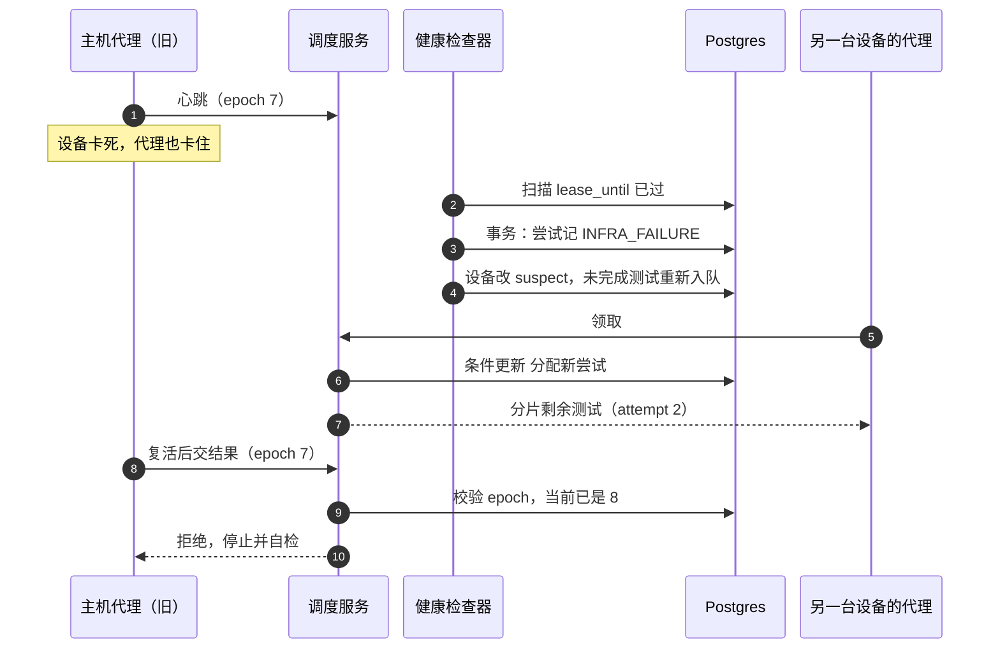

## Q
**设备在测试中途死掉**｜完整答案 · 测试执行平台（稀缺硬件上的大规模测试） · 必会

面试官：「一个 40 分钟的分片跑到第 30 分钟，设备不响应了，主机代理也可能跟着卡死。谁发现？谁把分片交给别的设备？已经跑完的测试怎么办？如果那台机器过了 5 分钟又活过来，把结果交上来呢？」

## A
**一句话。** 两条路发现：代理还活着时它从驱动错误或看门狗超时主动上报基础设施失败；代理也死了则心跳停止，租约 90 秒后过期，由健康检查器发现。无论哪条，都在一个事务里把这次尝试记为 `INFRA_FAILURE`、设备转 `suspect`、分片里未完成的测试重新入队（`attempt + 1`，排除这台设备），已流式上报的结果保留。机器复活后交上来的结果带旧的 `lease_epoch`，被拒绝。

**时序。**

**步骤。**
1. **发现：** 代理对每个测试设看门狗（超过预计时长若干倍无进展判卡死），驱动返回设备错误码也立即判定，上报 `complete(…, INFRA_FAILURE, 已完成测试列表)`；代理没上报、心跳也停了，则检查器每 15–30 秒扫 `lease_until < now()`，用 `FOR UPDATE SKIP LOCKED` 领取过期租约，多实例互不重复。
2. **一个事务收尾：** Attempt 标 `INFRA_FAILURE`（不是测试失败）并记发现方式；设备 `lease_epoch + 1` 转 `suspect` 交给诊断；已有结果的测试保留，未完成的组成新分片，`attempt + 1`，`exclude_devices` 加这台。重排的分片保留原入队时间，老化得分不清零，不排到队尾。
3. **重排上限与杀手测试：** 同一测试的基础设施重试最多 2–3 次，仍失败则结果是 `INFRA_ERROR`（不是 FAIL）单独显示；若同一测试在三台不同设备上都让设备死掉，多半是产品 bug（如触发硬件挂起），转为测试失败开问题单并停止重排，免得一个测试毁掉一排设备。
4. **旧代理复活：** 它的心跳和结果带 `epoch 7`，`WHERE lease_epoch = 7` 不满足，返回租约已失效；代理停止进程、清理现场、对设备自检，诊断通过后作为普通空闲设备重新领活。

**故障。**
- **结果部分上报：** 已完成的测试因流式上报已写入，正在跑的那个没有终态，按未完成重排；设备死前的日志块已在对象存储供诊断，死后那部分由诊断任务抓设备侧日志补。
- **检查器与代理同时判定：** 都以 `lease_epoch` 为条件更新，只有一个成功。
- **整个机架断电：** 很多租约同时过期，重排照常但把机架也作为排除维度，自动隔离超阈值时停下来告警人工，避免重排的分片又派给同机架设备。

**为什么这样。**
- 不把设备故障算成测试失败：开发者被无关失败打扰，很快不再信任平台。
- 不整片重跑：已完成的 30 分钟结果有效，只补未完成部分，省设备时间。

