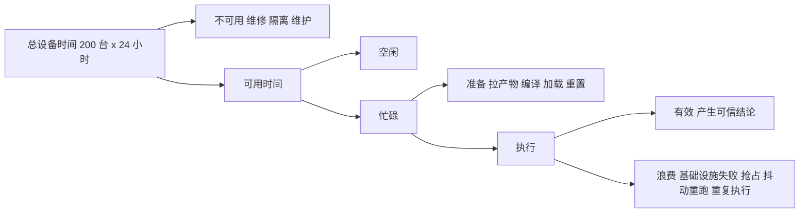

## Q
**产物、看板、成本与利用率**｜完整答案 · 测试执行平台（稀缺硬件上的大规模测试） · 追问

面试官：「一次运行会产生日志、性能曲线、设备转储，有的几十 GB。这些放哪、留多久？平台负责人每周要回答两个问题：设备时间花在哪了、发布还差多少。看板上放什么？」

## A
**一句话。** 产物由代理用预签名 URL 分块直传对象存储，结果只存链接；保留期按类别分层（预提交 7 天、夜间 30 天、发布资格与发布版本绑定长期保存），失败的运行比通过的留得久。看板围绕三类人：开发者看自己运行的状态和失败签名；值班看签名排行、抖动名单、回归；平台负责人看设备时间账：总时间拆成执行、准备、空闲、基础设施浪费、重跑和抖动，以及每个优先级的排队时间。

**设备时间去向。**

**步骤。**
1. **产物上传：** 代理向产物服务要预签名 URL，大文件分块上传（如 S3 的 `CreateMultipartUpload` → `UploadPart` → `CompleteMultipartUpload`），日志每几秒切一块、每块作为一个独立小对象上传（未完成的分块上传在 Complete 之前读不到），设备死掉前的部分不丢。键为 `runs/{run_id}/{test_id}/{attempt}/{name}`。
2. **元数据：** 结果库只存产物的键、大小、类型、哈希；看板按需生成短期下载链接。
3. **保留期：** 对象存储生命周期规则按前缀和标签执行：预提交 7 天、夜间 30 天；失败运行的产物延长；发布资格的产物随发布版本保存，供审计和事后比对；超过 30 天转低频存储类别。
4. **看板（开发者）：** 我的运行进度、每个失败的签名、是否抖动、同签名在别的提交上是否出现。
5. **看板（值班与发布）：** 夜间与发布资格的通过率趋势、按签名排行的失败、新出现的签名、抖动名单、发布候选的剩余测试与预计完成时间。
6. **看板（平台）：**
   - **利用率：** 忙碌时间 ÷ 可用时间，按设备型号和小时。
   - **有效设备时间（goodput）：** 产生可信结论的执行时间 ÷ 总设备时间；浪费按原因拆开。
   - **排队时间：** 每个优先级的 p50、p95 等待，以及预提交 p90 端到端时长。
   - **设备健康：** 每台设备的基础设施失败率、平均修复时间（MTTR）、隔离数量。
   - **准备开销：** 编译加载占忙碌时间的比例，衡量亲和调度的效果。
7. **成本分摊：** 设备小时按团队和优先级记账；每个测试的「年设备小时」排行，找出值得优化或挪到模拟器上的测试。

**故障与处理。**
- **产物上传失败：** 不影响测试结论；结果标记「产物缺失」，代理在本地保留一段时间后重试。
- **产物撑爆存储：** 单个测试的产物大小设上限；超限只保留摘要，并在看板上提醒负责人。
- **看板数字被误读：** 利用率高不代表好：如果浪费占比也高，说明设备在忙着失败。所以利用率和有效设备时间并排展示。
- **结果库查询拖慢接入：** 看板读 ClickHouse 的预聚合表（按小时、按测试、按设备），接入写明细，读写分开。

**为什么这样，不那样。**
- **不把产物经结果服务转发：** 几十 GB 的文件占满服务带宽，断了从头来；直传对象存储。
- **不只看利用率：** 只追利用率会让预提交排队变长，也会掩盖大量浪费。
- **不所有产物同样保留：** 绝大多数通过的预提交产物再也不会被打开。

**数字。**
- **可用设备时间：** 200 × 24 = 4,800 设备小时/天；每 1% 的浪费约 48 设备小时，相当于 2 台设备全天。
- **分块上传：** 每块 5 MiB 到 5 GiB，最多 10,000 块。
- **利用率目标：** 约 80%；在此之上排队时间迅速变长。
