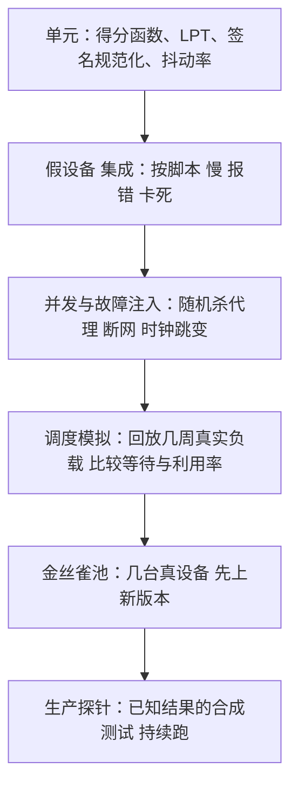

## Q
**怎么测试这个测试平台**｜完整答案 · 测试执行平台（稀缺硬件上的大规模测试） · 追问

面试官：「平台本身也会有 bug：调度器改了一个权重，预提交等待翻倍；租约逻辑有竞态，同一台设备被派了两个测试。硬件这么少，你怎么在不浪费设备的前提下测试这个平台？」

## A
**一句话。** 把硬件从大多数测试里拿掉：调度、租约、分片、抖动判定都是对「设备接口」编程的，用假设备（fake device，可以按脚本变慢、报错、卡死）在 CI 里跑单元和集成测试，并对关键不变量做随机化的并发测试；调度策略的改动用过去几周的真实负载在模拟器里回放，比较各优先级的等待时间和利用率；上线时先在一小部分真实设备组成的金丝雀池（canary pool）上跑，并用合成测试持续探测整条链路。

**测试分层。**

**步骤。**
1. **单元测试：** 得分函数（老化、紧迫度）、保底与借用的边界、LPT 装箱、签名规范化、抖动率；全部注入假时钟。
2. **假设备：** 实现与真设备代理相同的接口，测试时长、失败、卡死、慢启动都可以按脚本设定。几百个假设备跑在一台机器上，CI 每次提交都能跑。
3. **不变量测试：** 随机化的并发场景（成千上万次）下检查：
   - 任意时刻一台设备最多一个有效租约；
   - 每个分片最终到达终态（不丢、不卡）；
   - 旧纪元的结果从未被接受；
   - 基础设施失败从未被计为测试失败；
   - 同一测试同一尝试的结果只写一次。
4. **故障注入：** 随机杀代理、制造代理和服务之间的网络分区、让 Postgres 主从切换、让时钟跳变；断言上面的不变量仍然成立，且重排时间在目标内。
5. **调度模拟：** 记录过去几周的真实到达序列（何时提交、多少测试、各自时长、设备故障时间），在离散事件模拟器里用新旧两种策略回放；比较预提交 p90 等待、发布资格完成时间、利用率、抢占次数。差于旧策略就不上线。
6. **金丝雀池：** 新版本的代理和调度逻辑先只管理几台真设备，跑真实的夜间子集；对比同一测试在金丝雀池和主池的结果与时长。
7. **生产探针：** 每小时提交一个「已知应通过」和一个「已知应失败」的合成测试，还有一个故意抖动的测试（按概率失败），检查结果、签名、抖动判定都正确，端到端时长在目标内。
8. **健康检查自身的测试：** 用已知坏的设备（或注入错误的假设备）确认能被隔离，用已修好的确认能回池。

**故障与处理（测试本身）。**
- **假设备和真设备行为不一致：** 定期在真设备上跑一组「代理契约测试」，有差异就更新假设备。
- **模拟器的负载过时：** 负载模型每周从结果库自动刷新；发布周的负载单独保存一份，用来测高峰。
- **金丝雀池太小发现不了问题：** 关键改动在金丝雀池跑满一个夜间周期后再扩大。

**为什么这样，不那样。**
- **不在真硬件上测平台逻辑：** 设备是最稀缺的资源，而且真硬件的故障不可控、无法复现。
- **不只用单元测试：** 竞态和租约问题只在并发和故障下出现。
- **不靠上线后观察调度改动：** 等待时间的回归要几天才看得出来，期间开发者已经受影响；回放可以在上线前给出答案。

**数字。**
- **不变量测试：** 每次 CI 跑几千个随机场景，几分钟内完成。
- **回放：** 几周的负载在模拟器里几分钟跑完，可以同时比较多组参数。
