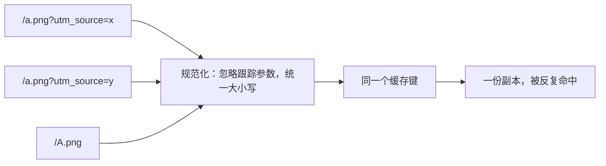

## Q
**CDN 命中率低先看缓存键**｜补充 · 缓存 · 必会

静态资源走 CDN，边缘命中率却只有 40%，源站压力没有降下来。缓存键上可能出了什么问题？怎么改？

## A
**结论。** CDN 默认用「完整 URL 加 Vary 指定的请求头」做缓存键。凡是不改变响应、却进了键的东西，都会把同一份内容拆成很多副本。把它们从键里去掉。

**要点。**
- **无关查询参数：** `?utm_source=…`、时间戳、参数顺序不同，每种取值一份副本。在 CDN 里忽略跟踪参数，或只保留白名单参数并排序。
- **Vary 到高基数的头：** `Vary: Cookie`、`Vary: User-Agent` 会按每个用户、每种浏览器版本拆分。静态路径不转发 Cookie，只对 `Accept-Encoding` 这类取值很少的头做 Vary。
- **大小写与主机名：** `/A.png` 和 `/a.png`、带不带 `www`，统一规范化再入键。
- **Set-Cookie 响应：** 不少 CDN 默认不缓存带 `Set-Cookie` 的响应，静态资源不要顺手种 Cookie。

**为什么。** 原则是「会改变响应字节的东西进键，其余一概不进」。多放一个无关维度，副本数就乘一次，每个副本被复用的机会就少一次。极端例子：每个请求都带随机时间戳参数，每个键只出现一次，命中率就是 0。

**面试里这样说。** 「命中率低我先查缓存键：规范化查询参数，静态路径不 Vary Cookie 和 User-Agent，只按 Accept-Encoding 区分压缩版本，再按资源类型拆开看是哪一类在拖低命中率。」

**易错。**
- **Vary User-Agent 做适配：** UA 字符串有几千种，等于不缓存；要先归成「手机、桌面」两类再进键。
- **只看总命中率：** 图片、脚本、接口混在一起，看不出是哪类资源的键被污染。
