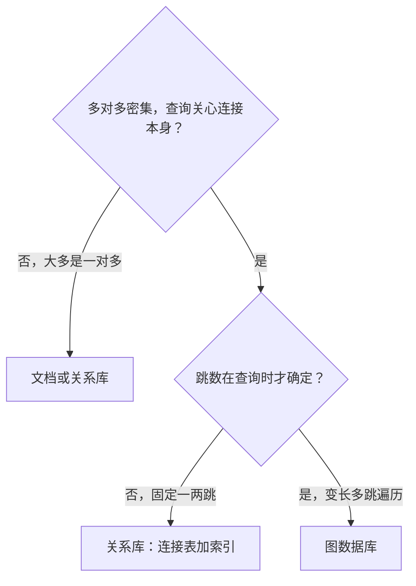

## Q
**什么样的数据和查询才值得上图数据库**｜补充 · 数据建模 · 追问

面试官：「你的数据最初是整齐的树状文档（用户→订单→商品）。数据形状出现什么变化，说明图模型比文档更合适？什么查询形状才值得为它引入图数据库，而不是关系库加连接表？」

## A
**结论。** 信号是多对多的连接越来越多，而且查询关心的是连接本身，要双向遍历。真正值得上图数据库的是跳数不固定的多跳遍历。固定一两跳的查询，关系库加索引的连接表就够了，面试里默认别选图库。

**要点。**
- **文档为什么吸收不了：** 文档是只有一个根的树。跨树的链接只是存一个 ID，跟过去要再查一次；反方向（谁引用了我）没有位置，除非手工维护镜像。
- **嵌入的后果：** 把共享实体嵌进每个父文档就是复制，更新异常又回来了。
- **图模型：** 顶点和边是一等公民、同质：任意实体可以互连，新增关系类型不需要改模式。
- **值得上图库的查询：** 好友的好友的好友、欺诈团伙、依赖链这类跳数在查询时才确定的遍历。关系库里每多一跳就多一次自连接，代价随整张边表增长；图库直接存邻接关系，代价随实际走过的边增长。
- **不值得：** 固定一两跳（「这个用户的好友」），连接表加索引就行，不必为此引入一个小众数据库的运维成本。

**面试里这样说。** 「大多是一对多就用文档或关系库；多对多密集、需要变长多跳遍历时才考虑图库。固定两跳以内的社交关系，我用带索引的关系表，因为多一套数据库的运维成本不值得。」

**易错。**
- **一提社交网络就上图库：** 常见的关注、好友列表是固定一跳，关系表就能撑住大规模。
- **在关系库里写不限深度的自连接：** 每增加一跳查询成本成倍增长，那才是该考虑图库的信号。
