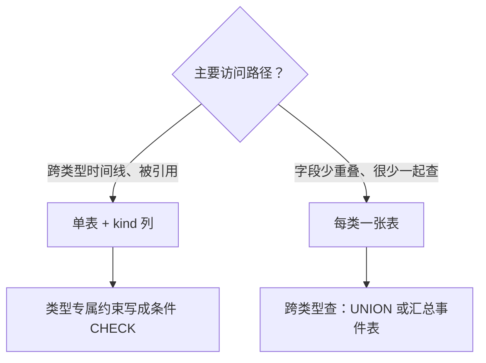

## Q
**几类相似记录：一张表加类型列，还是分表**｜补充 · 数据建模 · 追问

面试官：「发票、贷项通知单、退款是几类相似的记录。方案 A 是一张表加 `kind` 类型列，方案 B 是每类一张表。各自让什么变容易、什么变痛苦？」

## A
**结论。** 共享行为多、常跨类型查时间线，用单表加类型列。各类字段差别大、约束要精确、很少一起查，就分表。

**要点。**
- **单表的好处：** 「某账户所有财务事件按时间排序」是一次索引扫描，不用 UNION，只有一个分页游标，别的表只需引用一张表；新增类型不改表结构，审计、归档、权限只写一遍。
- **单表的痛处：** 类型专属的列对其他类型都是可空，数据库不再能强制「退款必须有原发票」，要靠条件检查约束或应用代码；索引和清理（vacuum）横跨所有类型，一个热点类型会拖累其他类型。
- **分表的好处：** 每类精确的非空和外键约束，各自独立的索引和保留策略，代码里没有按类型分支。
- **分表的痛处：** 跨类型查询和引用要 UNION，或另建一张同步的汇总事件表。
- **判断：** 各类很少共享字段、也很少一起查就分表；共同的时间线或被引用关系是主要访问路径就用单表。



```sql
CREATE TABLE financial_event (
  id bigint PRIMARY KEY, account_id bigint NOT NULL,
  kind text NOT NULL CHECK (kind IN ('invoice','credit_note','refund')),
  amount numeric NOT NULL, created_at timestamptz NOT NULL,
  original_invoice_id bigint REFERENCES financial_event(id),
  -- 类型专属约束写成条件 CHECK：退款必须引用原发票
  CHECK (kind <> 'refund' OR original_invoice_id IS NOT NULL)
);
-- 跨类型的账户时间线一次扫描
CREATE INDEX ON financial_event (account_id, created_at);
```

**面试里这样说。** 「主要访问路径是按账户查跨类型的时间线，所以我用一张表加 `kind`，类型专属约束写成条件 CHECK。如果各类字段几乎不重叠、也很少一起查，我会分表保住精确的约束。」

**易错。**
- **类型列加一堆可空列却没有约束：** 数据库再也拦不住缺字段的退款，脏数据靠应用代码兜底。
- **分表后没有汇总视图：** 想看账户总流水只能写大 UNION，每加一类要改所有报表。
