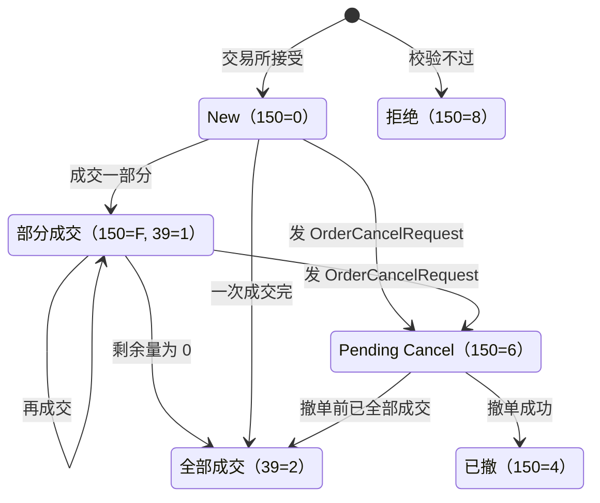

## Q
**FIX 订单回报：ClOrdID、ExecutionReport 与状态查询**｜补充 · 网络基础 · 追问

面试官：「券商用 FIX 下单。下单、成交、撤单的结果分别以什么消息回来？怎么把回报对到自己库里的订单？重复的成交回报怎么不重复记账？下单后网关崩了，不知道交易所收没收到，怎么查？」

## A
**结论。** 下单是 NewOrderSingle（`35=D`），带券商自己生成、在交易日内唯一的 `ClOrdID`（tag 11）；之后所有结果都是同一种消息 ExecutionReport（`35=8`），用 `ExecType`（tag 150）说"这次发生了什么"、`OrdStatus`（tag 39）说"订单现在什么状态"。每条成交回报有唯一的 `ExecID`（tag 17），以它去重；状态不明时用 OrderStatusRequest（`35=H`）按 `ClOrdID` 查。

**要点。**
- **对订单：** 回报里同时带 `ClOrdID` 和交易所分配的 `OrderID`（tag 37）。先写库存下 `ClOrdID`，回报到达时按它找到订单，第一次见到时补记 `OrderID`。
- **成交怎么记：** `ExecType=F`（Trade）的回报带本次成交量 `LastQty`（tag 32）、成交价 `LastPx`（tag 31），以及累计 `CumQty`（tag 14）和剩余 `LeavesQty`（tag 151）。成交表以 `ExecID` 为主键，插入成功才更新持仓；会话补发带 `PossDupFlag=Y` 的同一条回报会撞主键，被安全忽略。
- **撤单：** OrderCancelRequest（`35=F`）带新的 `ClOrdID` 和要撤的 `OrigClOrdID`（tag 41）。撤单成功回 `ExecType=4`；撤不了（已成交、找不到）回 OrderCancelReject（`35=9`）。撤单与成交可能交错，冻结资金要等最终状态的回报才释放。
- **查状态：** OrderStatusRequest（`35=H`）带 `ClOrdID`，交易所用一条 `ExecType=I`（Order Status）的 ExecutionReport 回答当前状态和累计成交；交易所回"未知订单"时，才说明它没收到这张单。查询要在下单后留出足够时间，否则可能与仍在路上的订单擦肩而过。

**故障与处理。**
- **发出后、收到 New 前网关崩溃：** 库里是 PENDING。清扫任务对超时的 PENDING 发 OrderStatusRequest，按结果改成 OPEN、FILLED 或 REJECTED，绝不在不知情时重下一张新单。
- **重复回报：** 会话补发和重连都会让同一回报再来一次，`ExecID` 唯一键使它无害。
- **乱序：** 持仓用每条成交的 `LastQty` 累加（经去重），订单状态只允许向前推进，旧状态的回报不回退。

**面试里这样说。** 「订单用自己的 ClOrdID 下，先落库再发；一切结果都是 ExecutionReport，成交以 ExecID 去重入账；不确定就按 ClOrdID 发 OrderStatusRequest 查，而不是重下。」
