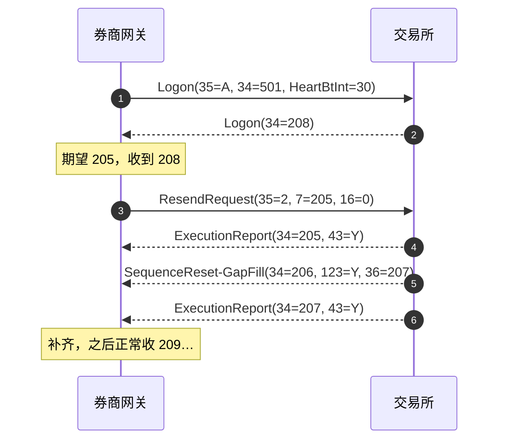

## Q
**FIX 会话：序号、心跳与断线补发**｜补充 · 网络基础 · 追问

面试官：「券商和交易所之间跑 FIX 协议。TCP 已经保证不丢不乱，为什么每条消息还要带序号？连接断了几秒，重连后双方怎么知道丢了哪些消息、怎么补？」

## A
**结论。** TCP 只在一条连接存活期间可靠，FIX 会话（session）跨越多次连接：双方各自给发出的每条消息编号（`MsgSeqNum`，tag 34），并把收发序号持久化。重连登录后，谁发现收到的序号比预期大，谁就发补发请求（ResendRequest，`35=2`）；对方重发缺的那段，业务消息带"可能重复"标记，不值得重发的管理消息用跳号（SequenceReset-GapFill）带过。

**步骤。**
1. **两个计数器：** 每一方都记"我下一条要发的序号"和"我期望对方下一条的序号"，写盘。序号属于会话，不属于 TCP 连接；通常每个交易日开始时双方同时归 1。
2. **登录：** 重连后先发 Logon（`35=A`），带上自己的当前序号和心跳间隔 `HeartBtInt`（tag 108）。
3. **发现缺口：** 收到的 `MsgSeqNum` 大于期望值，说明中间丢了，发 ResendRequest：`BeginSeqNo`（tag 7）= 期望值，`EndSeqNo`（tag 16）= 0 表示"之后的全部"。规范推荐用 0，双方同时补洞时恢复更快。
4. **对方重发：** 业务消息按原序号重发，带 `PossDupFlag=Y`（tag 43）和原始发送时间 `OrigSendingTime`（tag 122）；心跳、登录这类没必要重发的管理消息，用 `SequenceReset`（`35=4`）加 `GapFillFlag=Y`（tag 123）、`NewSeqNo`（tag 36）一笔带过。
5. **收到太小的序号：** 序号比期望小又没有 `PossDupFlag=Y`，说明双方状态错乱，按规范属于严重错误，应发 Logout 断开并人工核查。
6. **心跳：** 空闲超过 `HeartBtInt` 就发 Heartbeat（`35=0`）；太久没收到任何消息，发 TestRequest（`35=1`），对方必须回带同一 `TestReqID` 的心跳，再没有回应就判定连接已死。

**为什么这样。** 订单类消息丢一条是钱的问题：一条成交回报没收到，持仓就错了。序号让"丢了什么"可以精确地问、精确地补，而不是靠全量对账。

**面试里这样说。** 「FIX 的可靠性在会话层：双方持久化收发序号，重连登录后发现缺口就 ResendRequest，对方按原序号重发并标 PossDup；所以网关进程必须少而有状态，序号存盘。」

**易错。**
- **把序号当成订单 ID：** 序号只管传输，订单靠 `ClOrdID` 和交易所的 `OrderID` 识别。
- **随便重置序号：** 连接中途 `ResetSeqNumFlag` 归 1 会让缺口无从发现，只在约定的会话开始时做。
