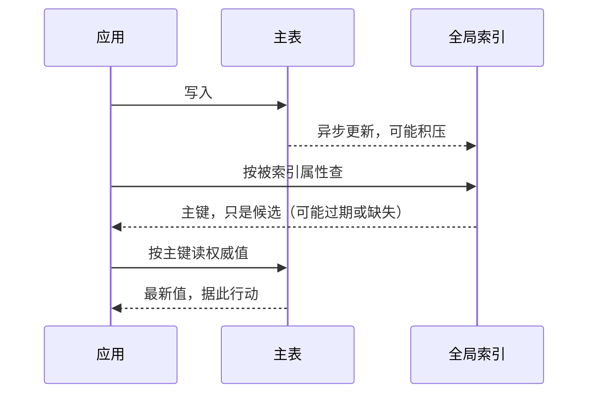

## Q
**异步全局索引给应用留下的坑**｜补充 · 分片（Sharding） · 追问

面试官：「全局二级索引是异步更新的。它会给应用逻辑带来哪两类问题？运维上还有什么常被忽略的坑？」

## A
**结论。** 应用层两个问题：写完立刻按索引查，可能查不到（读己之写失效）；索引可能返回过期的版本，基于它做读—改—写不安全。运维上，索引有自己的容量，吸收不了写入时会反压，把主表也限流。

**要点。**
- **读己之写失效：** 写入后立刻按被索引属性查询，这一项可能缺失；通常亚秒，索引被限流或积压时没有上界。写后重查的页面会显得坏掉。
- **索引只当候选键：** 它可能返回旧版本，或已经不满足条件的项；先用索引找到主键，再回主表读权威值，然后才能据此行动。
- **索引有自己的容量：** DynamoDB 里，如果全局索引的写容量吸收不了写入速率，主表的写入也会被限流：给查询加速的索引反过来拖垮了主表。
- **积压的表现：** 更新或删除之后，索引里留下已过期的条目，而不只是缺条目。

**面试里这样说。** 「我把全局索引当成候选键的查找：先按索引拿到主键，再回主表读最新值。刚写完就要看到的路径走主表，不走索引；索引的写容量要不低于主表，否则它会反压主表。」

**易错。**
- **用索引读的结果直接扣库存：** 读到的可能是旧版本，必须回主表确认再写。
- **索引容量配得比主表小：** 峰值时索引先被限流，主表写入跟着失败。
- **要强一致查询却用全局索引：** 它做不到，只能把数据按另一个键再写一张表，并和主表放进同一个事务。
