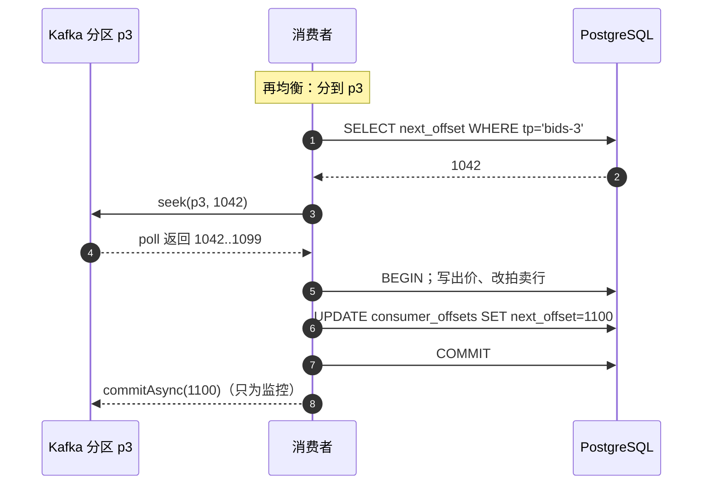

## Q
**位点和业务写进同一个数据库事务**｜补充 · Kafka · 追问

面试官：「消费者把出价写进 PostgreSQL。你说"处理完再提交位点"仍会重复。能不能让"处理"和"记住读到哪"变成一个原子动作？分区换了消费者，新消费者从哪读？」

## A
**结论。** 能，前提是结果只写一个数据库：把位点（offset）也当成业务数据，存进同一个库的一张表，和业务写在同一个事务里提交。提交了，两者都在；回滚了，两者都不在，所以不会出现"写了结果、位点没前进"的缝。Kafka 官方文档把这叫在 Kafka 之外保存位点（Storing Offsets Outside Kafka）。代价是：分区分到谁手里，谁就得自己去库里读位点，再用 `seek()` 跳过去。

**步骤。**
- **关自动提交：** `enable.auto.commit=false`，Kafka 自己存的位点不再是事实。
- **一张位点表：** `consumer_offsets(topic_partition PRIMARY KEY, next_offset)`，存"下一条要读的位置"，即最后处理的 offset + 1。
- **一批一个事务：** `poll()` 拿到一批，在同一个事务里写业务行和位点行，`COMMIT`。崩在 `COMMIT` 前，两者一起回滚，重启后从旧位点重读，结果只写一次。
- **分到分区时 seek：** `subscribe(topics, listener)` 传一个再均衡监听器（ConsumerRebalanceListener）。`onPartitionsAssigned` 里对每个新分区查表，`seek(tp, next_offset)`；表里没有就按 `auto.offset.reset` 从头或从尾。回调在 `poll()` 所在线程里执行，抓取恢复之前完成，所以第一条读到的就是 seek 后的位置。
- **Kafka 里的位点只是副本：** 事务提交后顺手 `commitAsync`，让 `kafka-consumer-groups` 和滞后告警（consumer lag）还能看到进度。恢复时只信数据库。

**为什么。** "处理"和"提交位点"分在两个系统，中间总有一个崩溃窗口；放进同一个事务，窗口就消失了。

**面试里这样说。** 「结果只写一个 Postgres，我就把位点也存进这个库，和出价同一个事务提交。分区分给我时，在 onPartitionsAssigned 里读表再 seek。Kafka 里的位点只用来看滞后。」

**易错。**
- **写库之后再 `commitSync` 当事实：** 两步之间崩溃，重启后按 Kafka 位点重读，这批会再执行一次。
- **结果写多个系统：** 一边写库、一边调外部接口或写另一个库，同一事务管不到，仍然要幂等键。
- **忘了自定义监听器：** 分区换手后新消费者按 Kafka 里的位点读。它是异步提交的副本，常比库里落后，落后的那段会被再执行一次，原子性就白做了。
