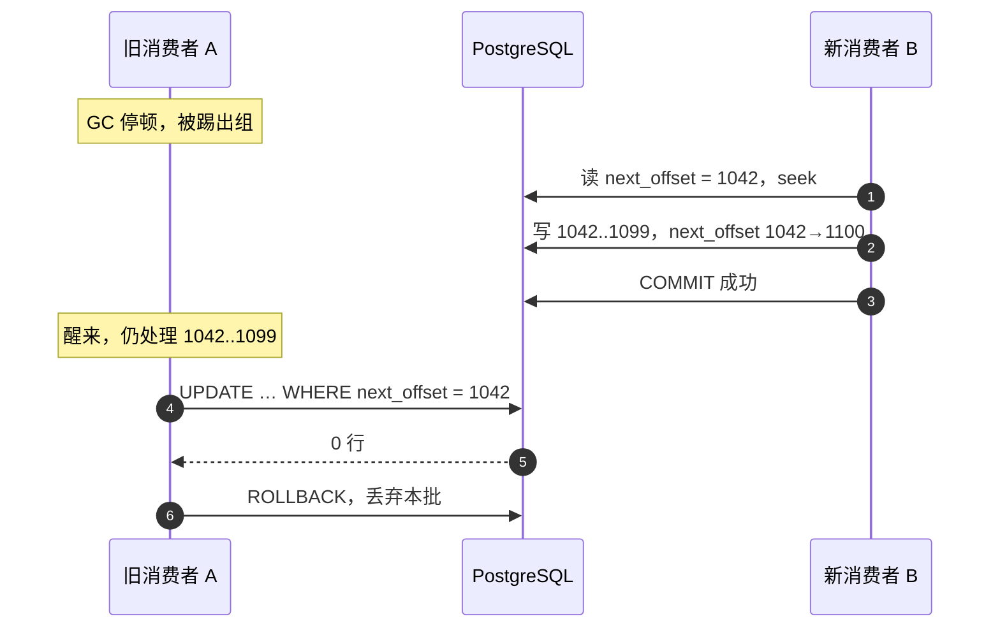

## Q
**位点存库时，挡住被踢出的旧消费者**｜补充 · Kafka · 追问

面试官：「位点和业务在同一个事务里。消费者 A 长时间 GC 被踢出组，分区给了 B。A 醒来还拿着那批消息，接着写库。会不会写两遍？」

## A
**结论。** 会，除非位点更新带条件。A 和 B 读的是同一段消息，单靠"同一事务"只保证每个事务内部原子，不保证只有一个事务成功。办法是把位点行当作乐观锁：`UPDATE … SET next_offset = :new WHERE topic_partition = :tp AND next_offset = :expected`，影响行数为 0 就回滚整个事务。先提交的那个赢，后到的那个整批作废。

**要点。**
- **谁检测被踢：** 组协调者（group coordinator）在 `session.timeout.ms` 内没收到心跳，或两次 `poll()` 间隔超过 `max.poll.interval.ms`，就把 A 移出组、触发再均衡。A 自己要到下一次 `poll()` 或提交失败才知道。
- **数据库才是裁判：** Kafka 的再均衡只决定"谁该读"，不阻止旧成员继续写库。条件更新让数据库拒绝过期写入，这就是围栏（fencing）：位点本身充当了版本号。
- **正常交接：** 协作式再均衡（cooperative）下，只有真正被收回的分区才会触发 `onPartitionsRevoked`。位点已随每个事务入库，这里不必再提交，只需停止处理这些分区。
- **分区丢失：** 会话过期这类情况走 `onPartitionsLost`，分区可能已经属于别人；默认实现直接调用 `onPartitionsRevoked`，不要在里面提交任何东西。
- **业务行也要有唯一键：** 例如出价表以 `bid_id` 为主键。条件位点挡住整批重放，唯一键再挡住任何漏网的单条重复。

**为什么。** "只有一个消费者读一个分区"是 Kafka 在正常情况下的约定，故障时会短暂破例；只有写入端自己核对版本，才能把破例变得无害。

**面试里这样说。** 「位点行带条件更新，期望值不对就整批回滚。被踢的旧消费者醒来写不进去，新消费者的结果只算一次。」

**易错。**
- **以为同一事务就够了：** 两个消费者各自的事务都能成功，结果各写一遍。
- **在 `onPartitionsLost` 里提交位点：** 分区已经归别人，提交会覆盖新主人的进度。
