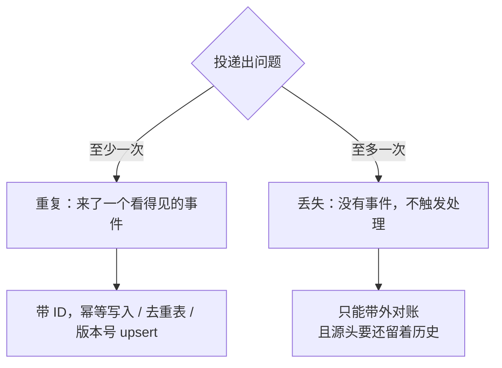

## Q
**为什么默认选至少一次**｜补充 · Kafka · 必会

面试官：「至多一次和至少一次之间，生产系统几乎都选至少一次，再想办法消除重复。丢消息和重复消息到底有什么不对称，让这个默认成立？」

## A
**结论。** 重复是「来了一个看得见的事件」，可以带上 ID，在下游中和；丢失是「该来的事件没来」，带内无从发现，只能靠带外对账，而且要求数据源还留着历史。至少一次把一种不可见、可能无法恢复的故障，换成了可见、可以工程化处理的故障。

**要点。**
- **重复可处理：** 事件带 ID，处理端用幂等写入、去重表或版本号 upsert 中和；做法局部、机械、可测试。
- **丢失没有信号：** 没有事件就没有处理函数被触发。只有定期拿条数或校验和去和数据源比对才发现得了，修复还要求源头保留着数据。
- **例外：** 数据可以丢弃、新鲜度优先的场景（心跳、位置上报），下一条会很快覆盖它；这里至多一次更合适，处理两次反而没有好处。
- **配套：** 至少一次必须配幂等消费者，同时保留对账作为兜底。

**为什么。** 两种失败的代价不对称：重复只多花一点算力，丢失可能是一笔永远补不回的订单。

**面试里这样说。** 「我默认至少一次，因为重复是看得见的，可以用事件 ID 去重；丢失是不会触发任何处理的，只能事后对账发现。只有心跳、位置这种马上被覆盖的数据才用至多一次。」

**易错。**
- **把至少一次当成不会重复：** 它保证的是不丢，重复照样会来，消费者必须幂等。
- **对可丢弃的数据也上重试和去重：** 为一条几秒后就被覆盖的位置更新付出复杂度，不划算。
