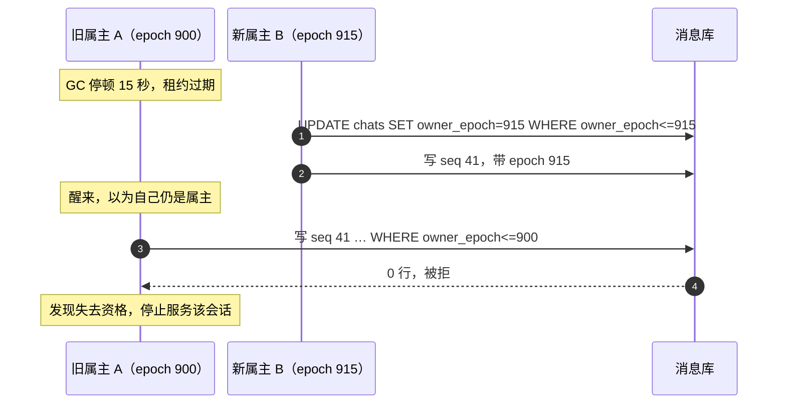

## Q
**租约选出的属主为什么还要带任期号写库**｜补充 · ZooKeeper · 追问

面试官：「etcd 已经保证同一时刻只有一个属主键。旧属主 A 停顿了 15 秒，租约早过期，B 已经接手。A 醒来时并不知道自己被撤了，接着给会话分配 seq、写消息库。怎么挡住它？」

## A
**结论。** 租约只保证 etcd 里的键是唯一的，不保证旧进程知道自己已过期。挡住旧属主要靠被写的那一方核对任期号：属主把当选时拿到的创建修订号作为 epoch 带在每一次写里，存储只接受不小于已见最大 epoch 的写。写的目标就是 etcd 时，用事务比较属主键的修订号；写数据库时，用条件更新。

**两种写法。**
- **写 etcd 本身：** 用事务 `Txn(If(CreateRevision(属主键) == 我的rev)).Then(Put(…))`。属主键已被删除或换人，比较失败，写入不执行。etcd 的事务里所有比较原子地一起判断。
- **写外部数据库：** 会话行存 `owner_epoch`。新属主上任时先把它推到自己的 epoch；之后每次写都带条件 `WHERE owner_epoch <= :my_epoch`（或在同一事务里先校验）。旧属主的 epoch 更小，写入影响 0 行。
- **只能单调增：** epoch 必须由一个全局单调的源发出。etcd 的修订号是全集群计数器，新属主的键一定是后创建的，所以修订号一定更大。

**还要做的。**
- **本地自我约束：** 属主在租约剩余时间不足时主动停止接新请求，这能缩小窗口，但不能消除它：GC 停顿期间进程连时钟都看不到。
- **发现被拒就退位：** 收到 0 行或比较失败，说明有新任期，立刻丢弃本地缓存的会话状态。
- **新属主接手：** 从数据库读 `max(seq)` 再继续分配，不信任任何内存里的值。

**为什么这样，不那样。**
- **只靠租约 TTL：** 只要存在比 TTL 更长的停顿（GC、虚拟机迁移、网络分区），就会有两个进程同时以为自己是属主。
- **靠时间戳当版本：** 不同机器的时钟不单调、不一致，不能用来排先后。

**面试里这样说。** 「租约选出属主，修订号当任期号。所有写都带任期号，由存储按条件更新拒绝旧任期，这样旧属主醒来也写不坏数据。」
