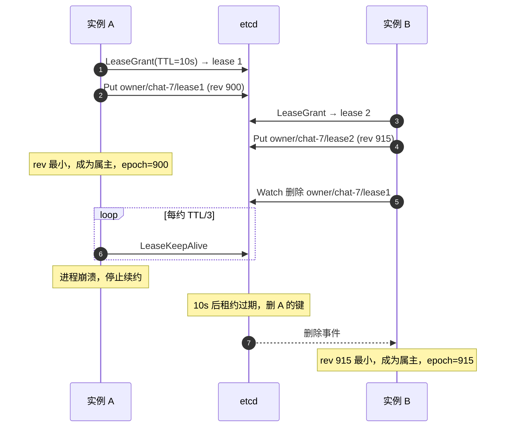

## Q
**etcd 租约选主：一个键、一个租约、一个修订号**｜补充 · ZooKeeper · 追问

面试官：「每个会话只能有一个属主实例，你说用 etcd 租约选。具体调哪些接口？属主进程挂了，谁发现、多久后别人接手？怎么知道'现在的属主是第几任'？」

## A
**结论。** 候选者先向 etcd 申请一个带 TTL 的租约（lease），用后台流持续续约；再在选举前缀下写一个绑定这个租约的键。前缀下创建修订号（create revision）最小的键就是属主，其他人监听排在自己前面的键被删除。属主进程死了就不再续约，TTL 到期后 etcd 删掉它的键，下一位成为属主。属主键的创建修订号在全集群单调递增，天然就是任期号（epoch）。

**步骤。**
1. **申请租约：** `LeaseGrant(TTL)`，服务端返回租约 ID 和实际 TTL。Go 客户端的 `concurrency.NewSession` 默认 60 秒，可用 `WithTTL` 改。
2. **续约：** `LeaseKeepAlive` 是一条双向流，客户端库自动按间隔续。etcd 在 TTL 内收不到续约，租约过期，所有挂在它上面的键一起被删除。
3. **参选：** `Election.Campaign` 在前缀下写 `前缀/<租约ID>` 这个键（用事务保证只在不存在时创建），然后等待前缀下所有创建修订号比自己小的键被删除。等到了，就是属主。
4. **当选后：** `Election.Rev()` 返回属主键的创建修订号，`Key()` 返回属主键。用 `Proclaim` 更新属主键的值（例如自己的地址），不必重新选举；主动交权用 `Resign`。
5. **其他人看属主：** `Observe` 返回一个通道，属主变化时推送最新值；路由层据此更新"会话 7 归谁"。
6. **谁发现死亡：** 不是别的实例，而是 etcd 自己：租约到期就删键，删除产生 watch 事件，下一位被唤醒。接手时间约等于 TTL 加一次 watch 通知。

**数字与取舍。**
- **TTL 取值：** 10 秒意味着属主宕机后最多约 10 秒无人负责；太短则一次 GC 停顿或网络抖动就丢掉属主资格。
- **修订号：** etcd 维护一个 64 位的全局修订号，任何写都让它加一，所以新属主的键一定比旧属主的修订号大。

**面试里这样说。** 「属主资格就是 etcd 里一个绑租约的键，创建修订号最小者当选，进程死了租约到期键被删，下一位接手；这个修订号就是任期号，下游写入都带上它。」
