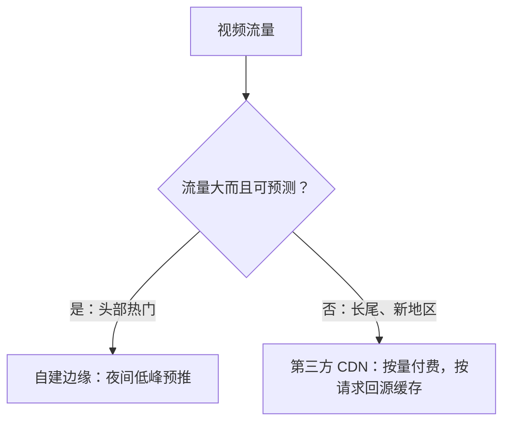

## Q
**头部用自建边缘，长尾用第三方 CDN**｜补充 · 视频平台（YouTube） · 追问

面试官：「视频流量巨大，你是全用商业 CDN，还是自己在运营商机房里部署缓存设备（类似 Netflix 的 Open Connect）？为什么很多平台两者并用？」

## A
**结论。** 自建边缘用固定的硬件和电力成本换近乎为零的边际流量成本，只在流量大而且可预测时划算，适合头部热门内容。长尾内容难预测、单片流量小，用按流量付费的第三方 CDN 更便宜、能弹性覆盖。

**要点。**
- **自建的账：** 设备和机架是固定成本，流量足够大时摊到每 GB 很低，越稳定越划算。
- **头部可预测：** 热门前一小部分视频占大部分播放，可以在夜里低峰把它们预先推送到边缘设备。
- **长尾不可预测：** 每部片流量小、新内容不断上传，预置的收益低，按请求回源缓存更合适。
- **只选一种的代价：** 全用商业 CDN，头部流量多付了弹性溢价；全自建，要为不可预测的长尾买一大批闲置容量。
- **自建的现实成本：** 要和运营商谈机架与电力，并且运维遍布全球的设备。

**为什么。** 固定成本只在利用率高时划算，所以把它用在最稳定的流量上，波动的部分留给按量计费。

**面试里这样说。** 「头部热门视频流量大而且可预测，我用自建边缘设备，夜间低峰预推内容，边际成本接近零；长尾和新地区用第三方 CDN 按量付费。全自建会为不可预测的长尾买闲置容量，全商业则在头部流量上多付钱。」

**易错。**
- **只讲缓存命中率：** 没说明成本结构，答不出为什么自建。
- **一开始就全自建：** 低流量阶段摊不平固定成本。
- **长尾也预推：** 预推的内容大部分没人看，浪费边缘存储和回填带宽。
