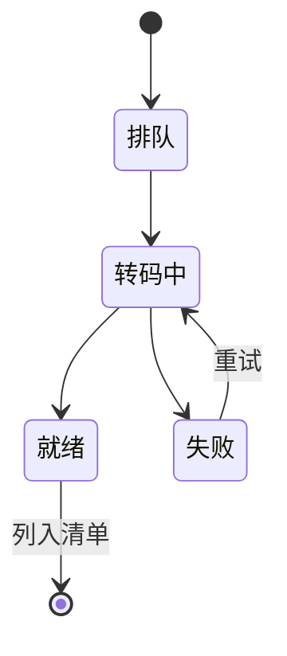

## Q
**一个视频有多个独立的转码产物**｜补充 · 视频平台（YouTube） · 追问

面试官：「一个视频会转出多个清晰度和编码的版本。你把这些版本做成 Video 记录上的字段，还是单独建表？如果 1080p 已经转好但 4K 还在排队，这个视频能播吗？」

## A
**结论。** 单独建一张产物表（VideoAsset），一个视频对应多行，每行是一个（编码、分辨率）组合，各有自己的状态。已就绪的档位先上线，其余的转好后再追加。

**要点。**
- **各自独立的任务：** 每个产物由独立的转码任务产出，成功、失败、重试的节奏各不相同。
- **自己的状态：** 每行有状态（排队、转码中、就绪、失败），1080p 就绪时 4K 可以还在重试。
- **清单只列就绪的：** 生成播放清单时只包含就绪的产物，视频一有可播放的档位就可以发布。
- **后续追加：** 新档位就绪后更新清单；播放器下次拉取清单时就能用上。
- **宽表的问题：** 把每个档位做成 Video 上的列，会有一堆可空列，每加一种编码就要改表结构。

**为什么。** 产物的生命周期互相独立，就该建成独立的行，状态才不会被迫耦合在一条记录里。

**面试里这样说。** 「我把 Video 和 VideoAsset 设计成一对多，每个产物一行，带自己的状态。清单只放就绪的产物，所以低档位转完视频就能发布，4K 稍后追加，不会因为最慢的一档拖住整个视频。」

**易错。**
- **所有档位都就绪才发布：** 最慢的那一档决定上线时间。
- **产物做成 Video 的字段：** 新增编码要改表，部分就绪也没法表达。
- **产物状态散落在别处：** 重试和对账找不到唯一的记录。
