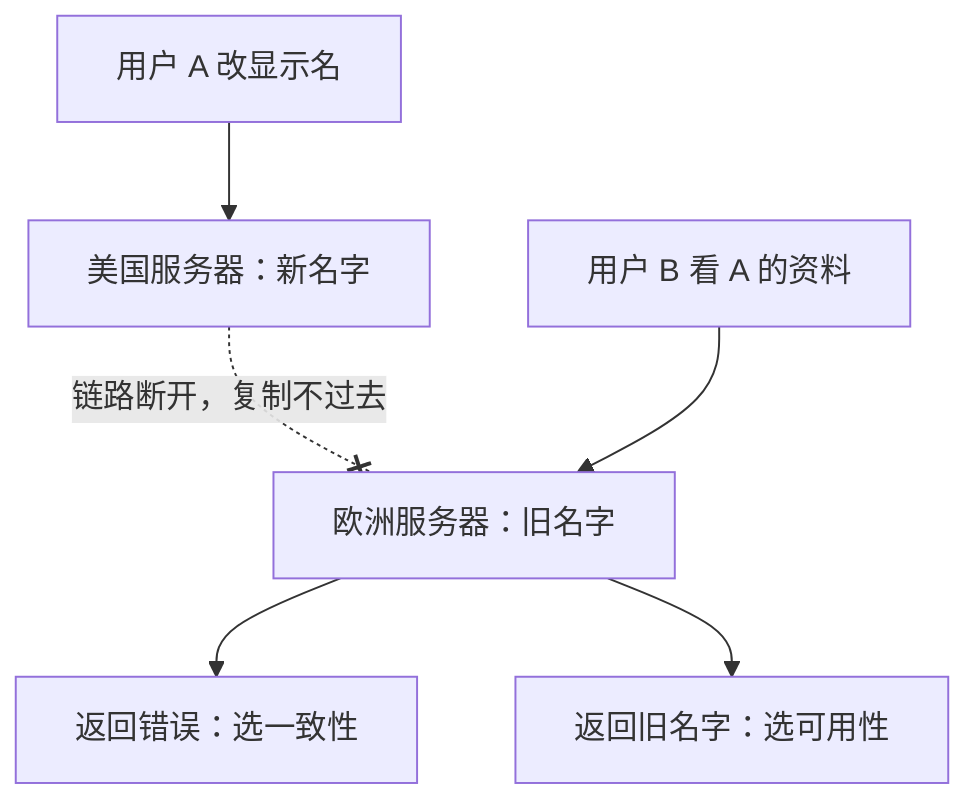

## Q
**双机房改名：分区发生时二选一**｜系统设计 · 核心概念

美国、欧洲各有一台服务器，用户 A 在美国改了显示名，更改会复制到欧洲。两地链路断开后，欧洲的用户 B 来看 A 的资料，系统可以怎么做？该怎么选？

## A
**两个选项。**
- 返回错误：无法确认数据是最新的，宁可不答（选一致性，牺牲可用性）
- 返回旧名字：可能过期，但能答（选可用性，牺牲一致性）

**怎么选。** 显示名这种数据，看到旧名字远好过看到报错，所以选可用性，等链路恢复后副本再追平（最终一致）。

**判断问法。** 「用户短暂看到不一致的数据，后果是不是灾难性的？」是，就选一致性；不是，就选可用性。

**说法。** 面试里把这个选择绑定到具体功能上说，而不是笼统地说「我们选 AP」。
