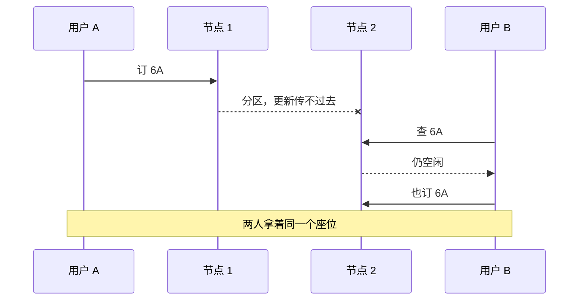

## Q
**必须选一致性的场景与设计手段**｜系统设计 · 核心概念

哪些系统在分区时宁可拒绝服务也要保一致性？选了一致性之后，设计上通常要引入什么，技术选型有哪些？

## A
**典型场景。**
- 订票：分区时 B 看到 6A 仍空闲并也订了，两人拿着同一个座位
- 电商库存：只剩一支牙刷却对多人显示可买，会超卖
- 金融交易：订单簿过期，会按错误价格成交

**设计手段。**
- 分布式事务（两阶段提交等），让缓存、数据库等多个存储同步更新；代价是复杂度和更高延迟
- 单节点方案：只用一个数据库实例，没有传播问题，但扩展性受限

**选型。** 传统关系库（PostgreSQL、MySQL）、Google Spanner、强一致模式的 DynamoDB。

**取舍。** 一致性是用延迟和可用性换来的，要说清楚换来的是什么业务保证。
