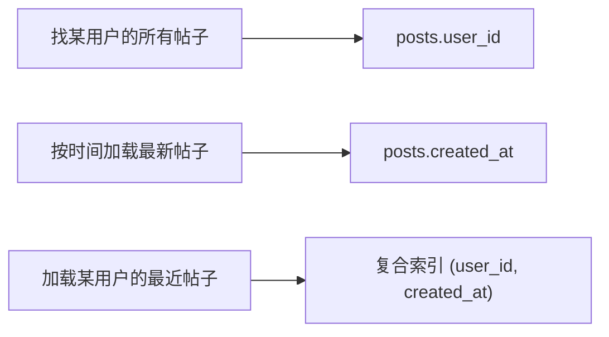

## Q
**按访问模式建索引**｜系统设计 · 核心概念

建模时怎样选索引？以社交应用的帖子表为例，应该建哪些，怎样在面试里说？

## A
**要点。** 索引是帮数据库不扫全表就能找到记录的数据结构，像书后的索引。建模时要点出哪些列有索引、为什么。索引应直接支持最重要的查询：
- `posts.user_id`：找某用户的所有帖子。
- `posts.created_at`：按时间加载最新帖子。
- **复合索引** `(user_id, created_at)`：高效加载某用户的最近帖子。

**为什么。** 索引不是越多越好：每个索引都增加写入开销和存储。要和 API 挂钩：「`GET /users/{id}/posts` 需要 `posts.user_id` 上的索引」，展示你在考虑真实查询性能。

**补充。** 索引的内部实现（B 树、哈希索引等）是另一个主题，这里只讲为哪些列建索引。

**易错。** 先有访问模式，再有索引，不要凭空列一堆索引。
