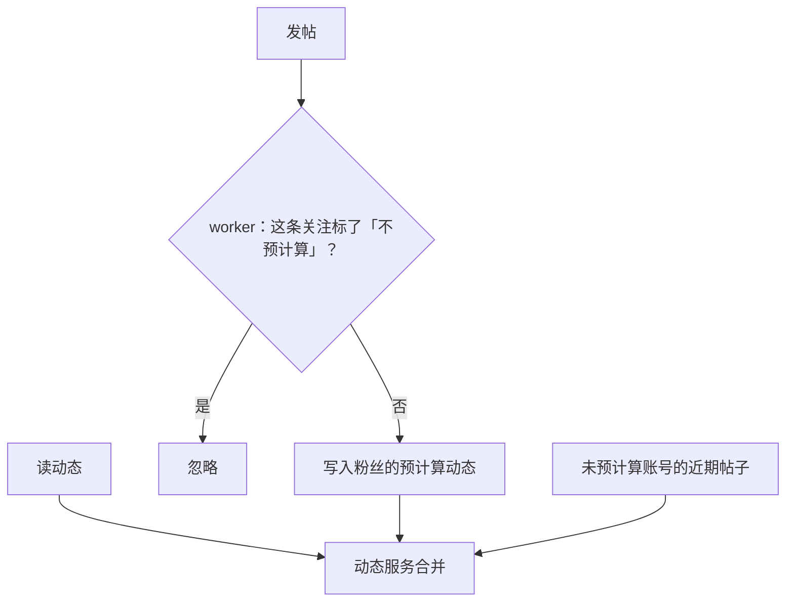

## Q
**混合动态：按账号选择扇出方式**｜系统设计 · 问题拆解

对粉丝数上亿的账号（如 Justin Bieber），写时扇出代价太大。混合动态（hybrid feed）怎么做？一般原则是什么？

## A
**要点。** 在 Follow 表上加一个标记，表示「这条关注不预计算」。异步 worker 遇到这类账号的发帖直接忽略。读动态时，动态服务取出用户（部分）预计算的动态，再与这些未预计算账号的近期帖子合并。

**为什么。** 这样每个账号可以单独选择是读时扇出还是写时扇出，大多数用户两者都用一点。

**取舍。** 好处是避开了一次写入上亿份动态；代价是读时要做合并，动态服务计算更多。预计算的粉丝数阈值可以调。

**要点。** 通用的设计原则：没必要用一刀切的方案，针对不同类型的问题用不同办法，再组合起来。
