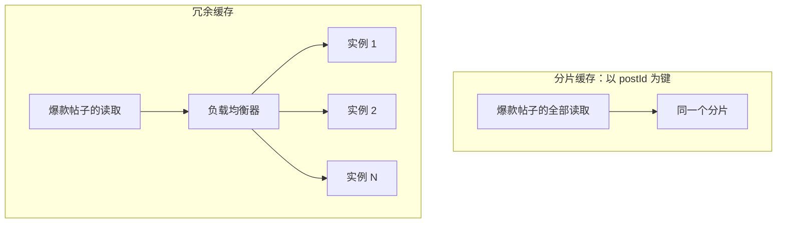

## Q
**热门帖子的读取热点**｜系统设计 · 问题拆解

热门帖子刚发布几小时内读取量极大，会造成存储热点键。缓存应该分片还是复制？各有什么利弊？

## A
**要点。** DynamoDB 这类键值库要求负载在键空间上均匀；如果 Post1 每秒 500 次请求，其他帖子为零，就不均匀。好在帖子很少被编辑，适合缓存：长 TTL、LRU 淘汰，被编辑时按 postId 失效缓存。

**取舍。**
- 分片缓存（Redis，以 postId 为键）：容量是 N×M，但同一个帖子只在一个节点，爆款帖子仍压垮那个分片，热点问题只是换了地方。
- 冗余缓存：每个实例都可服务任一帖子，由负载均衡器分流，互不协调；一个爆款帖子的读取分摊到 N 个实例，吞吐变成 N 倍。

**数字。** 代价是冷启动时爆款可能让数据库收到 N 次请求而不是 1 次，但 N 次远小于没有缓存时的数百万次。缓存容纳的帖子数更少，通常可以接受，因为 DynamoDB 能承受一定的读波动。

**使用时机。** 先说热键问题，再对比两种缓存。
