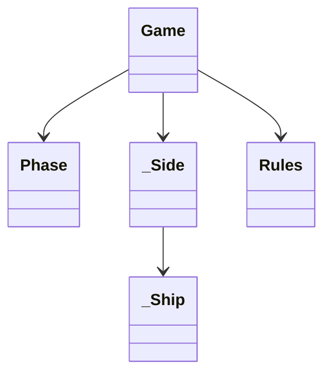

## Q
**设计海战棋（Battleship）游戏**｜低层设计

两名玩家各在自己的 N x N 棋盘上秘密摆一支舰队（长度不同的若干艘船），然后轮流向对方的坐标开火；每一炮的结果是落空、命中，或刚好打沉一艘船；先把对方所有船打沉的人获胜。系统要能防止非法摆放和非法开火（越界、重复、没轮到你），并跟踪每艘船和每块棋盘的状态。面试官看重的是：状态怎么建模、规则放在哪、校验和修改是否分开、以及加规则变体时代码会不会变成一团 `if`。

给出完整解答：需求、核心实体与接口、整体设计、核心实现、逐步扩展、深入问题、取舍、不同级别的期望。

## A
**一句话。** 每个玩家一份自己的状态（待摆舰队、"格子到船"的反查表、已被打过的格子），一个三态的阶段枚举驱动流程；每个公开方法先查阶段、再查参数、最后才改状态，所以任何非法操作都不留半成品。

**60 分钟路线。**

| 时间 | 做什么 |
|---|---|
| 0–8 分 | 问清规则：棋盘大小、舰队、谁先手、重复开火算不算回合、有没有变体；定接口 |
| 8–15 分 | 画实体：`Game`、每个玩家的 `_Side`、`_Ship`、`Phase`；写下开火的流程 |
| 15–45 分 | 写核心实现：摆放、开火、回合、胜负 |
| 45–50 分 | 跑例子：命中、击沉、重复开火、非法开火、获胜 |
| 50–60 分 | 追问：视图、规则变体、齐射、AI 对手 |

**需求。**
- 功能：
  - 摆放：每名玩家按舰队长度摆船，横竖皆可，不能越界、不能与自己的船重叠；两人都摆完才进入对战；
  - 开火：返回 `MISS`、`HIT` 或 `SUNK`；
  - 回合：玩家 0 先手，轮流开火；
  - 胜负：一方的船全部打沉，游戏结束；
  - 非法操作：越界、重复、没轮到、阶段不对，都要抛出明确的异常。
- 非功能：
  - 开火 O(1)，不扫全部船；
  - 校验失败不改变任何状态，也不消耗回合；
  - 规则变体（船不许相邻、命中后连击、每回合多炮）不靠子类，能自由组合。
- **船格 17 个占棋盘 17%：** 数字（默认 10 x 10、舰队 5、4、3、3、2）：船格共 5 + 4 + 3 + 3 + 2 = 17 个，占棋盘 100 格的 17%；打沉全部船至少需要 17 次命中，最坏打满对方整盘 100 炮；三个布尔规则开关组合出 2^3 = 8 种玩法，这是不用子类的理由。

**核心实体与接口。**
- `Phase`（枚举）：`PLACING`、`PLAYING`、`OVER`；
- `ShotResult`（枚举）：`MISS`、`HIT`、`SUNK`；
- `_Ship`：船占的格子集合 `cells` 和已被命中的格子 `hits`；`sunk` 是 `len(hits) == len(cells)` 现算的属性；
- `_Side`：一个玩家的状态，`to_place`（还没摆的长度）、`ships`、`at`（格子到船的字典）、`shots`（被打过的格子到是否命中）；
- `Game(size, fleet)`：`place_ship(player, row, col, length, horizontal)`、`fire(player, row, col)`，属性 `phase`、`current_player`、`winner`；
- 异常：`InvalidPlacementError`、`InvalidShotError`、`AlreadyFiredError`、`NotYourTurnError`、`GameStateError`，共同基类 `BattleshipError`；玩家编号不是 0 或 1 抛 `ValueError`。

**整体设计。**



`fire` 的流程固定为四步：
1. `_check_can_shoot`：玩家合法、阶段是 `PLAYING`、轮到他；
2. `_check_shot`：坐标在棋盘内、没打过；
3. `_apply`：在对手的 `_Side` 上记下这一炮，查 `at` 找到船，命中就加进 `hits`，返回 `MISS`、`HIT` 或 `SUNK`；
4. `_after_turn`：对手舰队全沉就结束游戏，否则换人。前两步只检查，第三步才改状态，所以失败的开火不消耗回合。

**核心实现。** 约 30 分钟，下面是全部要写的代码：

```python
from collections.abc import Sequence
from dataclasses import dataclass, field
from enum import Enum

Cell = tuple[int, int]


class ShotResult(Enum):
    MISS = "miss"
    HIT = "hit"
    SUNK = "sunk"


class Phase(Enum):                      # 三态代替两个布尔：只有三个合法状态
    PLACING = "placing"
    PLAYING = "playing"
    OVER = "over"


class BattleshipError(Exception): ...
class InvalidPlacementError(BattleshipError): ...
class InvalidShotError(BattleshipError): ...
class AlreadyFiredError(BattleshipError): ...
class NotYourTurnError(BattleshipError): ...
class GameStateError(BattleshipError): ...


@dataclass(slots=True)
class _Ship:
    cells: frozenset[Cell]
    hits: set[Cell] = field(default_factory=set)

    @property
    def sunk(self) -> bool:             # 派生状态现算，不另存一个会失同步的布尔
        return len(self.hits) == len(self.cells)


@dataclass(slots=True)
class _Side:                            # 每个玩家一份自己的状态
    to_place: list[int]                                     # 还没摆的舰队长度
    ships: list[_Ship] = field(default_factory=list)
    at: dict[Cell, _Ship] = field(default_factory=dict)     # 格子 -> 占着它的船：开火是一次查询
    shots: dict[Cell, bool] = field(default_factory=dict)   # 被打过的格子 -> 是否命中

    @property
    def alive(self) -> int:
        return sum(not s.sunk for s in self.ships)


class Game:
    def __init__(self, size: int = 10, fleet: Sequence[int] = (5, 4, 3, 3, 2)) -> None:
        if size < 1 or not fleet or any(not 1 <= n <= size for n in fleet):
            raise ValueError("bad size or fleet")
        self.size = size
        self._sides = [_Side(list(fleet)), _Side(list(fleet))]
        self.phase, self.current_player, self.winner = Phase.PLACING, None, None

    def place_ship(self, player: int, row: int, col: int, length: int, horizontal: bool) -> None:
        side = self._side(player)
        if self.phase is not Phase.PLACING:
            raise GameStateError("placement is over")
        if length not in side.to_place:
            raise InvalidPlacementError(f"no ship of length {length} left")
        cells = [(row, col + i) if horizontal else (row + i, col) for i in range(length)]
        self._check_cells(side, cells)                       # 先校验，通过了才改状态
        ship = _Ship(frozenset(cells))
        side.ships.append(ship)
        side.at.update({c: ship for c in cells})
        side.to_place.remove(length)
        if not self._sides[0].to_place and not self._sides[1].to_place:
            self.phase, self.current_player = Phase.PLAYING, 0

    def _check_cells(self, side: _Side, cells: list[Cell]) -> None:
        for r, c in cells:
            if not (0 <= r < self.size and 0 <= c < self.size):
                raise InvalidPlacementError("ship leaves the board")
            if (r, c) in side.at:
                raise InvalidPlacementError("ships overlap")

    def fire(self, player: int, row: int, col: int) -> ShotResult:
        self._check_can_shoot(player)
        target, cell = self._sides[1 - player], (row, col)
        self._check_shot(target, cell)                       # 校验与施加拆开：失败不消耗回合
        result = self._apply(target, cell)
        self._after_turn(player)
        return result

    def _side(self, player: int) -> _Side:
        if player not in (0, 1):
            raise ValueError(f"player must be 0 or 1, got {player!r}")
        return self._sides[player]

    def _check_can_shoot(self, player: int) -> None:
        self._side(player)
        if self.phase is not Phase.PLAYING:
            raise GameStateError(f"cannot fire in phase {self.phase.name}")
        if player != self.current_player:
            raise NotYourTurnError(f"it is player {self.current_player}'s turn")

    def _check_shot(self, target: _Side, cell: Cell) -> None:
        if not (0 <= cell[0] < self.size and 0 <= cell[1] < self.size):
            raise InvalidShotError(f"{cell} is off the board")
        if cell in target.shots:
            raise AlreadyFiredError(f"{cell} was already fired at")

    def _apply(self, target: _Side, cell: Cell) -> ShotResult:
        ship = target.at.get(cell)
        target.shots[cell] = ship is not None
        if ship is None:
            return ShotResult.MISS
        ship.hits.add(cell)
        return ShotResult.SUNK if ship.sunk else ShotResult.HIT

    def _after_turn(self, player: int) -> None:
        if self._sides[1 - player].alive == 0:               # 先判胜负，再谈换人
            self.phase, self.winner, self.current_player = Phase.OVER, player, None
        else:
            self.current_player = 1 - player
```

**运行。** 棋盘 5 x 5，舰队 `(3, 2)`，玩家 1 的船在 `(1,1)(2,1)(3,1)` 和 `(4,3)(4,4)`：
- 摆放没完成就开火，抛 `GameStateError`；两人摆完后 `phase` 是 `PLAYING`，`current_player` 是 `0`；玩家 1 抢先开火抛 `NotYourTurnError`；
- 玩家 0 打 `(4,3)` 得 `HIT`，打 `(4,4)` 得 `SUNK`；重复打 `(4,4)` 抛 `AlreadyFiredError`，坐标 `(9,9)` 抛 `InvalidShotError`，两者都没有消耗回合（`current_player` 仍是 `0`）；
- 再依次打 `(1,1)`、`(2,1)`、`(3,1)`：得 `HIT`、`HIT`、`SUNK`，最后一炮后 `phase` 是 `OVER`，`current_player` 是 `None`，`winner` 是 `0`，之后任何开火抛 `GameStateError`。

**逐步扩展。**
1. 【追问再讲】查询与视图：触发"玩家怎么看到棋盘"。`remaining_ships` 就是 `alive`；`board_view(viewer, owner)` 只暴露该看到的信息，`.` 未知、`o` 落空、`X` 命中，自己看自己时没被打到的船格显示 `#`，每次返回新列表，调用方改它不会伤到游戏。

```python
class Game:  # 只列出新增或替换的方法
    def remaining_ships(self, player: int) -> int:
        return self._side(player).alive

    def board_view(self, viewer: int, owner: int) -> list[str]:
        """owner 的棋盘在 viewer 眼里：'.' 未知，'o' 落空，'X' 命中，自己的船 '#'。返回新列表。"""
        self._side(viewer)
        side = self._side(owner)
        rows = []
        for r in range(self.size):
            line = []
            for c in range(self.size):
                if (r, c) in side.shots:
                    line.append("X" if side.shots[(r, c)] else "o")
                else:
                    line.append("#" if viewer == owner and (r, c) in side.at else ".")
            rows.append("".join(line))
        return rows
```

2. 【追问再讲】规则变体：触发"船不许相邻"、"命中后继续"。变体放进不可变的 `Rules`，默认值等于前面的规则；相邻检查只是 `_check_cells` 里多一个九宫格查询，连击只是 `_after_turn` 多一个参数。

```python
@dataclass(frozen=True, slots=True)         # 规则是不可变的配置，传进 Game 后外面改不了
class Rules:
    touching_allowed: bool = True           # False：自己的船之间（含斜角）不能相邻
    extra_turn_on_hit: bool = False         # True：命中或击沉后同一玩家继续


class Game:  # 只列出新增或替换的方法
    def __init__(self, size: int = 10, fleet: Sequence[int] = (5, 4, 3, 3, 2), rules: Rules | None = None) -> None:
        if size < 1 or not fleet or any(not 1 <= n <= size for n in fleet):
            raise ValueError("bad size or fleet")
        self.size, self.rules = size, rules or Rules()
        self._sides = [_Side(list(fleet)), _Side(list(fleet))]
        self.phase, self.current_player, self.winner = Phase.PLACING, None, None

    def _check_cells(self, side: _Side, cells: list[Cell]) -> None:
        for r, c in cells:
            if not (0 <= r < self.size and 0 <= c < self.size):
                raise InvalidPlacementError("ship leaves the board")
            if (r, c) in side.at:
                raise InvalidPlacementError("ships overlap")
            if not self.rules.touching_allowed and any(      # 九宫格里有自己的船就是相邻（对手的船不算）
                    (r + dr, c + dc) in side.at for dr in (-1, 0, 1) for dc in (-1, 0, 1)):
                raise InvalidPlacementError("ships may not touch")

    def fire(self, player: int, row: int, col: int) -> ShotResult:
        self._check_can_shoot(player)
        target, cell = self._sides[1 - player], (row, col)
        self._check_shot(target, cell)
        result = self._apply(target, cell)
        self._after_turn(player, extra=self.rules.extra_turn_on_hit and result is not ShotResult.MISS)
        return result

    def _after_turn(self, player: int, extra: bool = False) -> None:
        if self._sides[1 - player].alive == 0:               # 获胜的那一炮仍然结束游戏
            self.phase, self.winner, self.current_player = Phase.OVER, player, None
        elif not extra:
            self.current_player = 1 - player
```

3. 【加分】齐射：触发"每回合一次打出存活舰数那么多炮"。`fire_salvo` 先把每一发都校验完（含齐射内部互相重复），全部通过才统一施加；这正是核心里把 `_check_shot` 和 `_apply` 拆开的回报。

```python
@dataclass(frozen=True, slots=True)
class Rules:
    touching_allowed: bool = True
    extra_turn_on_hit: bool = False
    salvo: bool = False                     # 新：每回合一次打出"自己存活舰数"那么多发


class Game:  # 只列出新增或替换的方法
    def fire(self, player: int, row: int, col: int) -> ShotResult:
        self._check_can_shoot(player)
        if self.rules.salvo:                                 # 新：齐射模式只能用 fire_salvo
            raise GameStateError("use fire_salvo in salvo mode")
        target, cell = self._sides[1 - player], (row, col)
        self._check_shot(target, cell)
        result = self._apply(target, cell)
        self._after_turn(player, extra=self.rules.extra_turn_on_hit and result is not ShotResult.MISS)
        return result

    def fire_salvo(self, player: int, cells: Sequence[Cell]) -> list[ShotResult]:
        self._check_can_shoot(player)
        if not self.rules.salvo:
            raise GameStateError("salvo mode is off")
        if len(cells) != self._sides[player].alive:
            raise InvalidShotError(f"a salvo has exactly {self._sides[player].alive} shots")
        target, seen = self._sides[1 - player], set()
        for cell in cells:                                   # 先整体校验：任何一发非法，整个齐射都不生效
            self._check_shot(target, cell)
            if cell in seen:
                raise AlreadyFiredError(f"{cell} appears twice in the salvo")
            seen.add(cell)
        results = [self._apply(target, cell) for cell in cells]   # 全部通过，才统一施加
        self._after_turn(player)                             # 齐射后一律换人
        return results
```

**运行（逐步扩展）。** 同一块 5 x 5 棋盘，舰队 `(3, 2)`：
- **touching 规则示例：** `Rules(touching_allowed=False)`：玩家 0 已在 `(0,0)` 起横放 3 格，再在 `(1,1)` 起横放 2 格抛 `InvalidPlacementError`（斜角相邻），改放在 `(2,0)` 就可以；
- **extra_turn_on_hit 示例：** `Rules(extra_turn_on_hit=True)`：玩家 0 打 `(4,3)` 得 `HIT`，仍是玩家 0；再打 `(3,3)` 得 `MISS`，换成玩家 1；
- **board_view 的两种视角：** `board_view(0, 1)` 的第 4、5 行是 `...o.`、`...X.`（玩家 0 眼里对手的棋盘），`board_view(0, 0)` 第 1 行是 `X##..`（自己的船，`(0,0)` 已被命中）；
- `Rules(salvo=True)`：`fire` 抛 `GameStateError`；`fire_salvo(0, [(4,3), (9,9)])` 抛 `InvalidShotError`，`(4,3)` 没有被打，回合仍是玩家 0；`fire_salvo(0, [(4,3), (4,4)])` 得 `[HIT, SUNK]`，换成玩家 1。

**深入。**
1. 【必讲】阶段枚举加入口守卫：
   - 两个布尔（`started`、`finished`）有四种组合，其中两种没有意义，非法组合在代码里无处可防；`Phase` 只有三个合法状态；
   - 每个公开方法先查阶段、再查参数、最后改状态，写成 `if self.phase is not Phase.PLACING: raise ...` 这样的守卫（枚举状态加守卫）；
   - 胜负判定放在换人之前：打沉最后一艘船时 `current_player` 变 `None`，不会出现"赢了但还轮到对手"。
2. 【必讲】数据模型：
   - 每个玩家一份 `_Side`，`at` 是格子到船的反查字典，开火是一次查询；每炮扫描全部船的全部格子是 O(舰队格数)，每炮都要付（反向索引）；
   - 沉没由 `len(hits) == len(cells)` 现算，用 `@property`，不另存布尔。另存就要在每次命中时同步，漏一处就出现"打满了却没沉"（派生状态不存储）；
   - `_Side` 的列表和字典字段用 `field(default_factory=...)`：直接写 `= []` 会被数据类拒绝，因为可变默认值会被所有实例共享，两个玩家就会共用同一份棋盘；
   - 船只有长度，不做 `Carrier`、`Destroyer` 之类的子类：各种船行为完全相同，差别只是数据，规则变体也只需改配置。
3. 【必讲】校验与施加分开：
   - `_check_shot` 只检查，`_apply` 只修改。单发开火复用这一对，齐射先校验全部再施加，不需要回滚（两阶段：先验证后施加）；
   - 重复开火、越界开火必须不消耗回合，这是顺序的直接后果：检查在 `_after_turn` 之前，失败就抛出，换人那一步根本没执行。
4. 【追问再讲】规则变体用配置不用继承：三个布尔开关能自由组合出 2^3 = 8 种玩法，用子类要写 8 个或者多重继承；`@dataclass(frozen=True, slots=True)` 的 `Rules` 不可变，传进 `Game` 之后外面改不了，`slots` 去掉每个实例的 `__dict__`（不可变配置对象）。
5. 【追问再讲】视图只暴露该看的：对手的船位只通过"已被打过"的格子泄露，自己的船才显示 `#`。放弃让调用方直接拿内部字典，那会泄露对手的船位。
6. 【追问再讲】相邻检查：九宫格 `(dr, dc)` 取 -1、0、1，含斜角；只查自己的船（`side.at`），对手的船不算，因为两块棋盘是分开的。
7. 【加分】对战循环放在 `Game` 之外：AI 对手只通过 `board_view` 和 `fire` 说话，引擎不用改；多于两名玩家时 `_sides` 的列表索引和 `1 - player` 要换成按顺序轮转，目标选择变成参数。
8. 【加分】回放、悔棋、网络对战：把每个成功的操作记成事件，状态由事件重放得到；联网时服务器是唯一的裁判，客户端拿到的只是 `board_view`，永远拿不到对手的内部状态。

**取舍与追问。** 按被问到的可能性排，通常口述就够：
- 想支持任意形状的船：`_Ship` 本来就存格子集合，只要 `place_ship` 接受格子列表即可。
- 想让 AI 先猜后追：策略放在 `Game` 外，输入是 `board_view`，输出是下一发坐标；被击中后优先试四邻格。
- 为什么不用二维数组存格子状态：反查字典只存有意义的格子，开火是 O(1)，并且天然把"格子到船"的关系带着；二维数组还得再找船。
- 并发：回合制，同一时刻只有一个玩家可以动，`Game` 里整体加一把锁就够。
- 随机摆放：校验函数 `_check_cells` 可以复用，摆放失败就重试。

**级别期望。**
- 中级：核心实现通过，摆放和开火正确，错误分类清晰，能说清回合和胜负。
- 高级：阶段枚举、反查字典、派生状态不另存；校验与施加分离；视图返回副本且不泄露对手。
- 资深/专家：规则用配置而不是子类并说清组合爆炸；齐射一类变体靠两阶段复用；对战循环、AI 与引擎解耦；事件重放与网络对战。

**先修概念。**
- [[hi-low-level-design-in-a-hurry-delivery|答题框架]]
- [[hi-low-level-design-in-a-hurry-oop-concepts|面向对象概念]]
- [[hi-low-level-design-in-a-hurry-design-principles|设计原则]]
- [[hi-low-level-design-in-a-hurry-patterns|设计模式]]

**同类题。**
- [[solution-tic-tac-toe|设计题解：井字棋]]
- [[solution-snake-and-ladder|设计题解：蛇梯棋]]
- [[solution-chess|设计题解：国际象棋]]
- [[hi-low-level-design-problem-breakdowns-connect-four|四子棋（Connect Four）]]
