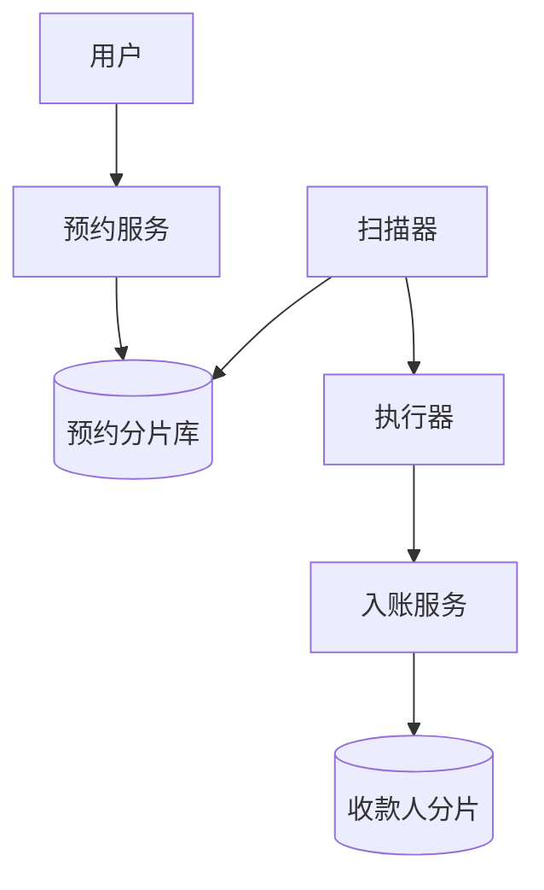

## Q
**设计延迟支付调度服务（到点自动转账）**｜系统设计

设计一个服务：用户 A 可以预约"过一段时间后把一笔虚拟货币（如 Robux）转给用户 B"，例如"48 小时后给 B 付 100"、"2 小时后给 D 付 300"。延迟时间由用户指定，时间一到系统自动完成转账。面试官常追问：钱什么时候从付款人那里扣（预留）、到点后转账如何做到不重不漏、付款人取消与到点执行同时发生、某个时刻到期的任务特别多、执行失败怎么办、怎样对账。

给出完整解答：需求、核心实体与接口、整体设计、深入问题、取舍、不同级别的期望。

## A
**一句话。** 这是"持久化定时器 + 恰好一次的资金转移"：定时器要放在数据库里并能被多个执行者安全地抢占，转账靠预留资金、状态机的条件更新和以 `holdId` 为键的幂等入账，在"至少一次投递"的前提下得到"有效一次"的结果。

**60 分钟路线。**

| 时间 | 做什么 |
|---|---|
| 0–5 分 | 问清需求，估算：约 116 笔/秒，高峰约 580 笔/秒 |
| 5–10 分 | 实体（钱包、预约、账本）、状态机和接口 |
| 10–25 分 | 整体设计：创建时预留资金；扫描器抢占到期任务；幂等入账 |
| 25–50 分 | 必讲深入：定时器放哪里、怎么找到期任务；恰好一次转账；取消与执行的竞争 |
| 50–60 分 | 追问：到期高峰、失败补偿、对账、分片 |

**需求。**
- 功能：
  - 创建预约（hold）：付款人、收款人、金额、执行时间（延迟可从几分钟到约 30 天）；
  - 到点自动把钱转给收款人；
  - 到点之前付款人可以取消，钱退回；
  - 查询预约状态与我的预约列表。
- 非功能：
  - 绝不重复转账、绝不丢失，余额永远不为负；
  - 到点后 p99 在 5 秒内执行（假设值，决定扫描间隔）；
  - 任何一台机器崩溃，预约不丢、不卡死；
  - 可对账、可审计。
- **预约量估算：** （假设 1,000 万笔预约/天，平均延迟 24 小时）：
  - 创建速率 10,000,000 ÷ 86,400 ≈ 116 笔/秒，峰值按 5 倍约 580 笔/秒；
  - 在途预约（利特尔定律）≈ 116 × 86,400 ≈ 1,000 万条，每行约 200 B，热数据约 2 GB，规模很小；
  - 每笔约 5 次写（预约行、预留分录、抢占、入账、完成），峰值约 2,900 次写/秒；单分片可持续约 1,000 次写/秒（假设），留一半余量按 500 算，需要 6 片，取 8 片。

**核心实体与接口。**
- 实体：
  - 钱包（Wallet：`userId`、`available`）；
  - 预约（Hold：`holdId`、`payer`、`payee`、`amount`、`executeAt`、`status`、`leaseUntil`、`attempts`）；
  - 账本分录（LedgerEntry：`userId`、`holdId`、`kind`、`amount`，对 `(holdId, kind)` 加唯一约束）。
  - 状态：`SCHEDULED → EXECUTING → COMPLETED`；`SCHEDULED → CANCELLED`；`EXECUTING → FAILED`（重试耗尽，退款给付款人）。
- 接口：
  - `POST /holds`（头 `Idempotency-Key`；体：收款人、金额、`executeAt` 或延迟秒数）→ `{holdId}`；
  - `DELETE /holds/{id}`：到点之前取消；
  - `GET /holds/{id}`、`GET /holds?status=`。
- 按付款人分片：创建与取消都围绕付款人，扣款和写预约行能放进同一个本地事务。

**整体设计。**



创建（同步，一个本地事务）：
1. 校验收款人存在、金额大于 0，按 `Idempotency-Key` 去重。
2. **扣款用条件更新防透支：** `UPDATE wallet SET available = available - :a WHERE user = :payer AND available >= :a`，影响 0 行就拒绝（余额不足）。
3. **预约时就冻结可用余额：** 插入预约行（`SCHEDULED`）和一条 `RESERVE` 分录，提交后返回。钱在这一刻就离开了可用余额，到点时不会出现"余额不够"的失败。

到点执行（异步，至少一次 + 幂等）：
1. 每个分片上的扫描器每秒抢占一批到期任务，抢占即把状态改为 `EXECUTING` 并设租约（lease）。
2. 执行器向收款人所在分片发起入账，键为 `holdId`；已入过账则是空操作。
3. 入账成功后把预约改为 `COMPLETED`。步骤 2 与 3 之间崩溃，租约到期后任务被重新抢占，重新入账是空操作，再完成即可。

```sql
-- 抢占：到期的 SCHEDULED，或租约过期的 EXECUTING；SKIP LOCKED 让多个扫描器互不阻塞
UPDATE holds SET status='EXECUTING', lease_until=now()+interval '60 s', attempts=attempts+1
WHERE hold_id IN (
  SELECT hold_id FROM holds
  WHERE (status='SCHEDULED' AND execute_at<=now()) OR (status='EXECUTING' AND lease_until<now())
  ORDER BY execute_at LIMIT 200 FOR UPDATE SKIP LOCKED)
RETURNING *;
```

**深入。**

1. 【必讲】定时器放哪里、怎么找到期任务。
   - 选择：预约行就是定时器，在 `execute_at` 上建只含未完成状态的部分索引（partial index），扫描器按时间顺序取前 200 条。
   - 为什么不用别的：Redis 有序集合快但崩溃可能丢，也无法和扣款放进一个事务；消息队列的延迟投递有上限（常见只有几分钟到十几分钟）；Kafka 本身没有延迟；每分钟全表扫描会随数据量线性变慢。
   - 精度：扫描间隔 1 秒，加上排队，p99 约 2–3 秒，满足 5 秒目标。要更精确，可让扫描器把未来 1 分钟内要到期的任务预取到内存小顶堆里，到点直接执行。

2. 【必讲】恰好一次转账：靠"至少一次 + 幂等"，不靠分布式事务。
   - 创建时先预留（扣付款人、记 `RESERVE`），本地事务；执行时只剩"给收款人加钱"这一个跨分片动作，且它天然幂等（`(holdId, CREDIT)` 唯一约束，重复插入失败即视为已完成）。
   - 顺序不能反：先入账、后标记完成。反过来，标记完成后崩溃，钱就丢了。
   - 崩溃点逐个看：抢占后崩溃，租约到期重试；入账后崩溃，重试时入账是空操作；完成后崩溃，已是终态，不会再被抢占。

3. 【必讲】取消与执行的竞争：用条件更新决出唯一胜者。
   - 取消：`UPDATE holds SET status='CANCELLED' WHERE hold_id=? AND status='SCHEDULED'`，同一事务里写 `RELEASE` 分录并加回余额；影响 0 行说明已被抢占或完成，返回 409。
   - 抢占语句同样要求 `status='SCHEDULED'`，两者对同一行互斥，要么取消赢，要么执行赢，不会都赢。

4. 【追问再讲】到期高峰。
   - 场景：用户常选"午夜"这类整点，或故障恢复后积压。假设一分钟内到期 100 万条：入账加完成约 3 次写，8 片满负荷 8 × 1,000 ÷ 3 ≈ 2,700 笔/秒，约 375 秒（六分多钟）清完，所以高峰要靠限速和扩容，不能指望常态容量。
   - 措施：按 `execute_at` 先到期先处理；扫描器水平扩展（SKIP LOCKED 保证不重复）；对入账服务限速，保护它不被打垮；监控"最老未执行任务的延迟"并告警。

5. 【追问再讲】失败补偿与重试。
   - 暂时性失败：指数退避，把 `lease_until` 推到未来；最多重试约 10 次。
   - 永久性失败（收款账户被封、注销）：写 `REFUND` 分录退回付款人，状态 `FAILED`，通知付款人。
   - 重试耗尽进人工队列，不静默丢弃。

6. 【追问再讲】对账。后台每天核对不变量：所有钱包余额 + 所有未完成预约金额 = 总发行量；每条 `COMPLETED` 的预约都恰有一条 `CREDIT` 分录，反之亦然；差异报警。

7. **【加分】用 Temporal 定时器：** 用工作流引擎（如 Temporal）的定时器代替自建扫描器：持久化定时器和重试开箱即用，但 1,000 万个长期在途的工作流成本高，且资金状态仍需放进数据库；适合预约量小、流程复杂（多步审批）的场景。

**取舍与追问。** 按被问到的可能性排，通常口述就够：
- 创建时预留还是到点才扣：预留保证到点必能成功，代价是资金被占用；到点才扣可能失败，要处理"余额不足"，产品上通常不可接受。
- 为什么不做两阶段提交：跨分片只有一个幂等入账，用不着；两阶段提交在协调者故障时会阻塞。
- 时钟：`execute_at` 用 UTC，比较时用数据库时间，不用各台扫描器的本地时间。
- 修改执行时间：等价于取消再创建，但要在同一个事务里，避免两个都存在或两个都不存在。
- 吞吐翻 10 倍：分片翻倍到 16–32，扫描器按分片水平扩展；热点用户（大商家一次创建很多预约）不会成为瓶颈，因为按付款人分片、写入仍是每条独立行。

**级别期望。**
- 中级：画出数据库存预约、定时扫描到期任务、执行转账的流程，知道要防重复转账。
- 高级：创建时预留资金、条件更新的状态机、抢占 + 租约、幂等入账键、取消与执行的竞争。
- 资深/专家：用数字说明为何数据库足够、崩溃点逐个论证、到期高峰的限速与积压指标、补偿与对账不变量、与工作流引擎的取舍。

**先修概念。**
- [[hi-system-design-patterns-dealing-with-contention|处理争用（Contention）]]
- [[hi-system-design-patterns-long-running-tasks|长时间运行的任务]]
- [[hi-system-design-core-concepts-db-indexing|数据库索引]]
- [[hi-system-design-core-concepts-sharding|分片（Sharding）]]
- [[hi-system-design-deep-dives-temporal|Temporal]]

**同类题。**
- [[hi-system-design-problem-breakdowns-job-scheduler|分布式任务调度（Airflow）]]
- [[hi-system-design-problem-breakdowns-payment-system|支付系统（Stripe）]]
- [[design-payment-ledger|练习：设计支付账本]]
- 支付批处理系统：同样要处理"结果不确定"与幂等
